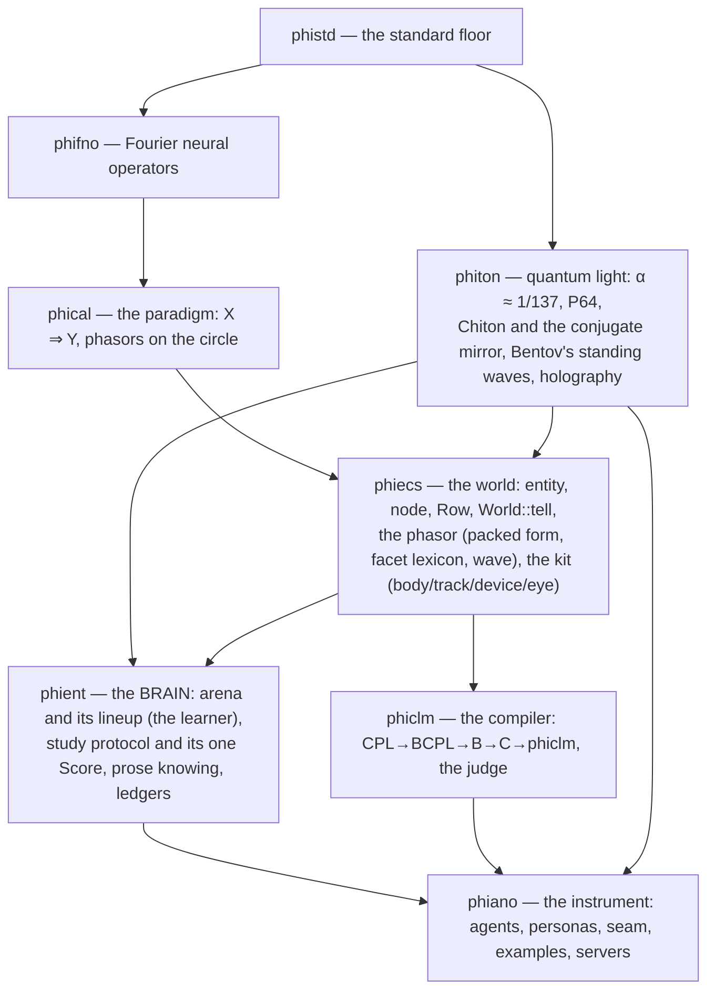
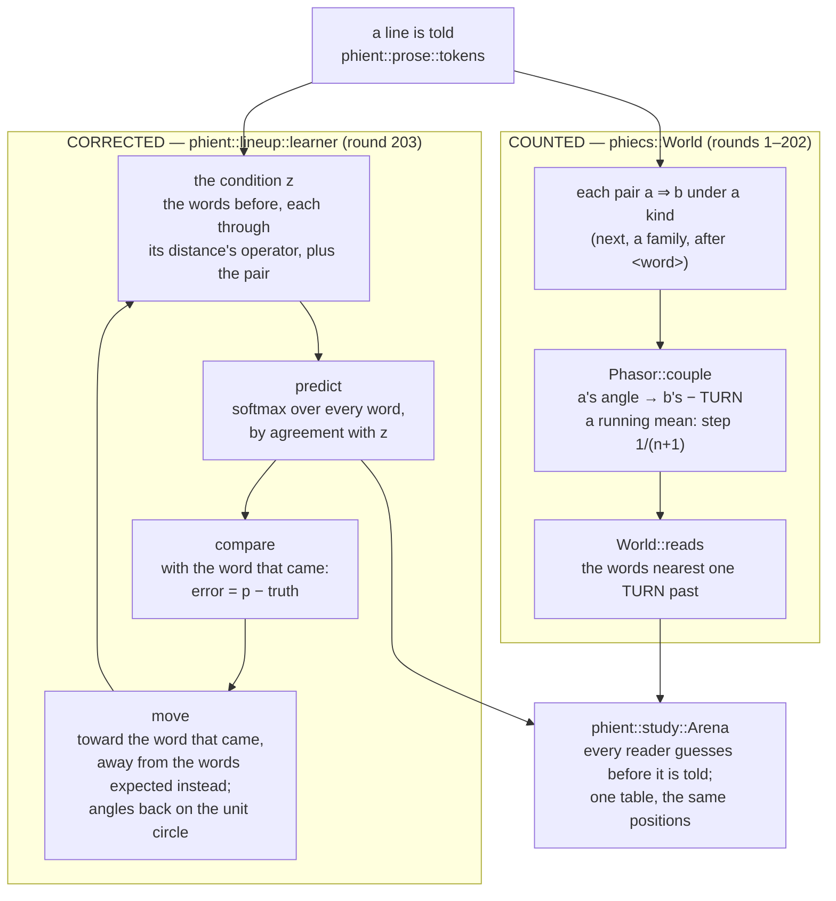
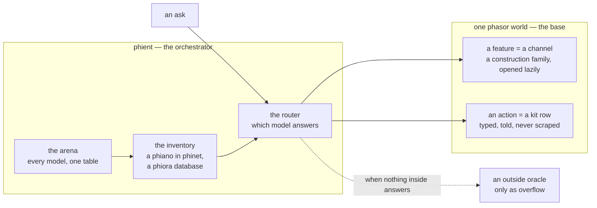
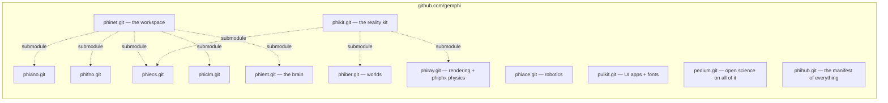
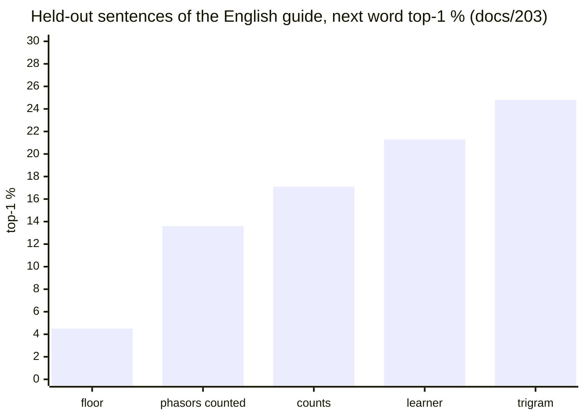

# phinet — architecture

## The crates, as dependencies run (downward only)

## Where learning lives — counted, and corrected (docs/203)

## The single layer (docs/197)

## The repositories, as submodules run

## Where it stands (docs/203)

## Each crate, drawn

- [phistd](crates/phistd/ARCHITECTURE.md) · [phifno](crates/phifno/ARCHITECTURE.md) · [phical](crates/phical/ARCHITECTURE.md) · [phiecs](crates/phiecs/ARCHITECTURE.md)
- [phient](crates/phient/ARCHITECTURE.md) · [phiclm](crates/phiclm/ARCHITECTURE.md) · [phiton](crates/phiton/ARCHITECTURE.md) · [phiano](crates/phiano/ARCHITECTURE.md)

Notes: [docs/notes.md](docs/notes.md) · What is left to do: [TODO.md](TODO.md)
