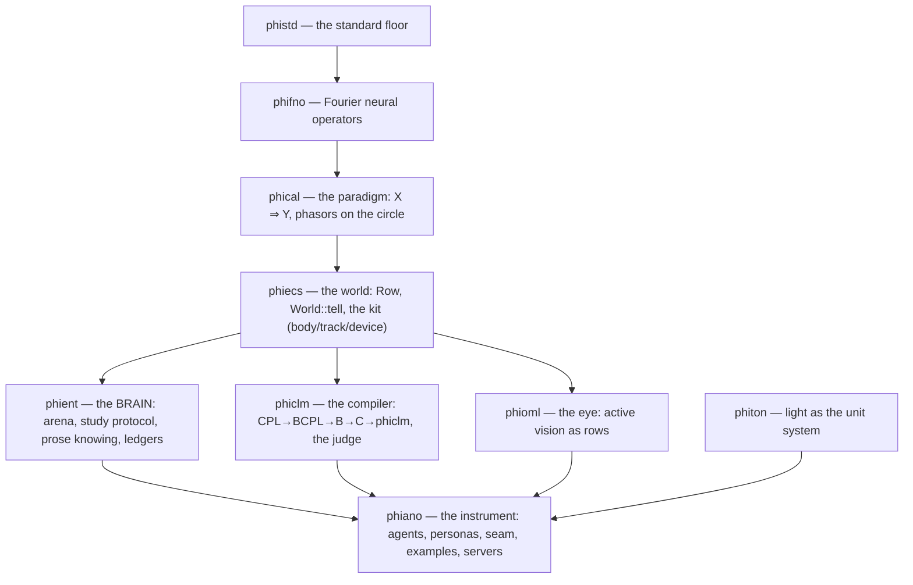
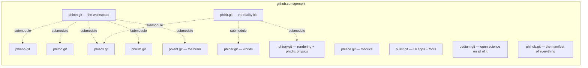

# The architecture — how each crate maps to the rest

In Phient's world, a word (w) is a seed: what it relates to, under what conditions (c), grows from it. The Phical paradigm, X ⇒ Y, drives and composes Phient's Phasor Language Models: Phinet, Phiano, PhiTon. Phical stores no point: a word is 32–64 relations, each a complex phasor on a closed circle with a count; meaning is a side effect of pairs of words moving under a condition.

## The crates, as dependencies run (downward only)

An arrow means "is depended on by". Nothing points upward; the brain (phient) sits between the world and the instrument because it must not know the applications — it knows the MODELS (the arena: counts, concepts, phasors, mirror, operator), the protocol (predict first, learn after) and the trees of knowing, and phiano plugs its readers into that arena from above. phiecs additionally dev-depends on phient for tests only (cargo permits the cycle there).

## The repositories, as submodules run

phiecs appears twice on purpose: one repo, two superprojects — phinet consumes it as the world under the models, phikit owns it as the kit under the realities. In-tree in phinet (no repo of their own): phistd, phical, phioml, phiton.

## The single layer (docs/197)

One phasor world is the base everything else is a cheap condition on: a feature is a channel (a construction family opened lazily), an action is a kit row (typed, told, never scraped), and **phient is the orchestrator** — it holds the arena, knows its inventory (a phiano in phinet, a phiora database), routes an ask to the model that answers it, and reaches an outside oracle only as overflow. The same shape Apple runs Siri and its utilities on — one base model, LoRA adapters per feature, a declared App-Intents vocabulary, a router — arrived here by the paradigm's own sentence.

## Where the honest numbers live

Every crate's README states what is measured; the round-by-round record is `crates/phiano/docs/001–197`, conditions of satisfaction fixed before each run, the numbers against us included: phasors lead the glosses arena 32.9% vs counts 29.9% and trail counts on prose 13.9% vs 21.4%; Key completion 15.7% vs 20.1%; a whole book told in 3.6 s, no retraining.
