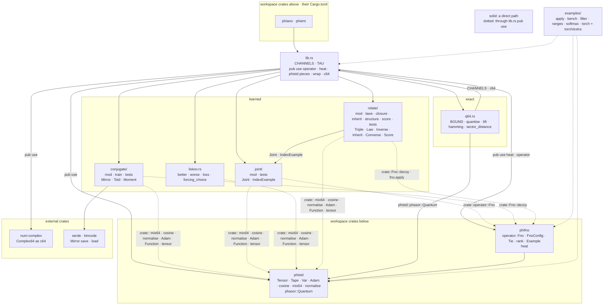
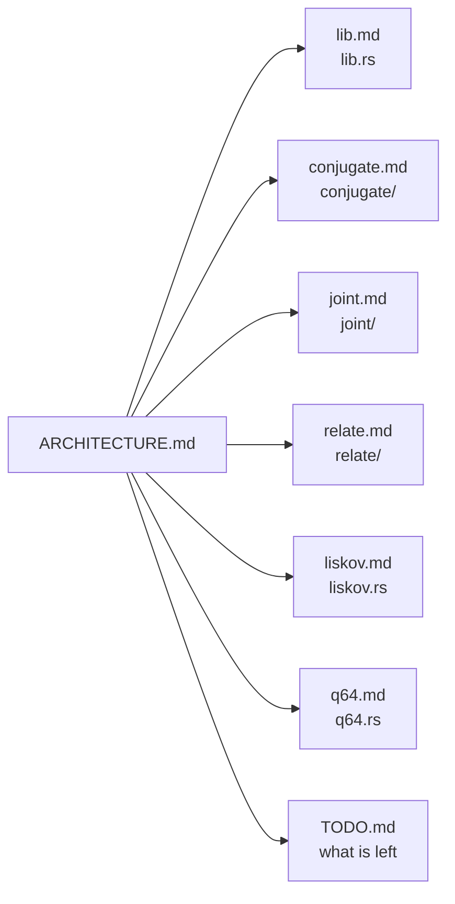

# phical — architecture

## The crate, module by module

## The module pages

| diagram | file |
|---|---|
| the crate root and its re-exports | [docs/phical/lib.md](../../docs/phical/lib.md) |
| the phase-conjugate mirror | [docs/phical/conjugate.md](../../docs/phical/conjugate.md) |
| the operator and the table, trained together | [docs/phical/joint.md](../../docs/phical/joint.md) |
| relations, laws, closure, inheritance, the reading | [docs/phical/relate.md](../../docs/phical/relate.md) |
| better · worse · loss | [docs/phical/liskov.md](../../docs/phical/liskov.md) |
| the C64/Q64 juncture | [docs/phical/q64.md](../../docs/phical/q64.md) |

## Status

2026-10-27 · 19 test functions · what is left: [TODO.md](TODO.md)
