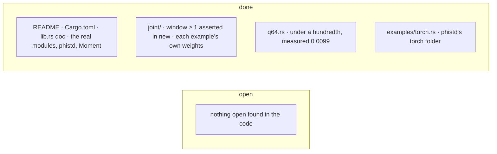

# phical — TODO

## lib.rs
- nothing open found in the code

## conjugate/
- [x] The phase-conjugate mirror moved to `phiton::conjugate`, beside `chiton`; its decoy draw is `phistd::decoy`.

## joint/
- [x] `context_on_tape` reads each example's own weight (a constant row per example, `Tape::mul`); identical to before for today's position-only schedules, tested with two that differ.
- [x] `Joint::new` asserts `window ≥ 1` with a message, before any epoch.

## liskov.rs
- nothing open found in the code

## q64.rs
- [x] The q64 test is `…_is_under_a_hundredth` and asserts `< 0.01`: measured 0.0099, the module doc's figure.

## relate/
- nothing open found in the code

## README.md · Cargo.toml
- [x] Module table: `sphere`, `mobius`, `winding` removed; `q64`, `heat` (phifno's) and the crate root's re-exports listed; Cargo.toml's description to match.
- [x] The example imports `phical::unit_random`; phistd, not phinet, is named as the engine.
- [x] `Moments` is `Moment`.
- [x] The examples named as `examples/` holds them: `apply`, `bench`, `filter`, `ranges`, `softmax`, `torch`.
- [x] lib.rs's crate doc names phistd as the engine.

## examples/
- [x] `torch.rs` points to `crates/phistd/torch/phinet_torch.py` and runs `-p phical --example torch` from crates/phistd.

## Added for phisor (2026-10-29)

- [x] `classes`: a class bigram table's likelihood, one word's `move_gain` (O(k)) and `apply_move`, and `split_cost` (BIC for one more class), tested against the likelihood recomputed from scratch.
- [x] `liskov::staged`: `Staged`, `better` (3.6), `worse` (3.8 read for a learner: any lower stage is worse).
- [x] The exchange loop itself: phisor's `exchange/{table,halve,pay}` copied here as `classes/{table,halve,pay}` with only the paths changed, its three halving tests with it. phisor keeps `Units` and switches its callers.
- [x] phisor's own copy is in `_temp/phinet-root/phisor-exchange-before-phical/` (INVENTORY row). Its callers read `phical::classes::{halve, Grow, Halving}`, and the kinds run is unchanged: 53 word classes at depth 7.

## Moved in (2026-10-28)

- [x] helix: phiano's helix code (`Codon`) is `helix` (docs/phiano/distribution).
