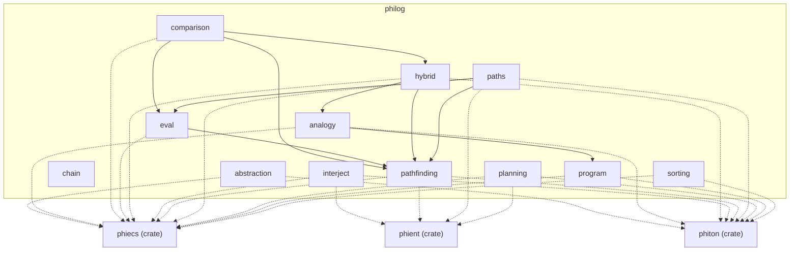

# philog — architecture

## The modules and what they use

## The crate in one diagram

- [reasoning](../../docs/philog/reasoning.md): the engines, the chain, and what reads them

What is left to do: [TODO.md](TODO.md)
