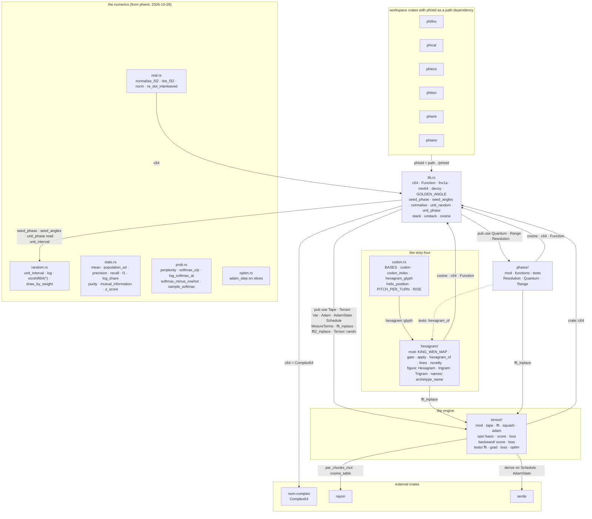
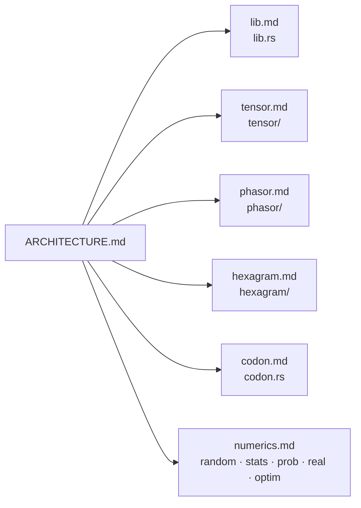

# phistd — architecture

## The crate, module by module

## The module pages

| diagram | file |
|---|---|
| the crate root: seeds, hashes, functions | [docs/phistd/lib.md](../../docs/phistd/lib.md) |
| the tensor engine: tape, ops, backward, FFT, Adam | [docs/phistd/tensor.md](../../docs/phistd/tensor.md) |
| the phasor ranges | [docs/phistd/phasor.md](../../docs/phistd/phasor.md) |
| the sixty-four gates | [docs/phistd/hexagram.md](../../docs/phistd/hexagram.md) |
| the sixty-four as three bases | [docs/phistd/codon.md](../../docs/phistd/codon.md) |
| the numerics phient used to write inline | [docs/phistd/numerics.md](../../docs/phistd/numerics.md) |

## Status

2026-10-29 · 36 lib tests (the numerics add 9; the table readings 1) · what is left: [TODO.md](TODO.md)
