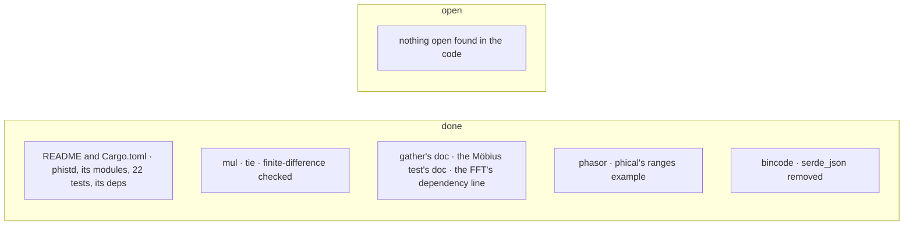

# phistd — TODO

## README.md · Cargo.toml
- [x] README names the crate `phistd` throughout (title, `use`, the dependency line, `phistd::phasor`).
- [x] README's module table lists what src/ holds: `tensor`, `phasor`, `hexagram`, `codon`, `hrr`, the crate root.
- [x] README describes the 22 `#[test]` functions there are.
- [x] README's parity commands run phical's `torch` example; its examples line names `profile` and `table`.
- [x] README and the Cargo.toml description name what is used: num-complex, rayon, serde.
- [x] `bincode` and `serde_json`, used nowhere, are gone from Cargo.toml.

## lib
- nothing open found in the code

## tensor/
- [x] `Tape::mul` and `Tape::tie` are finite-difference checked (`tests/mul_tie.rs`, with `tie`'s copy-forward, sum-backward); lib.rs's "every gradient is checked" holds.
- [x] `gather`'s doc sits on `gather`, `tie` keeps its own.
- [x] The Möbius test's doc names what it checks.
- [x] tensor/mod.rs says the FFT needs nothing outside the crate, not that the module has no dependencies.

## phasor/
- [x] phasor/mod.rs points to phical's `ranges` example.

## hexagram
- nothing open found in the code

## codon
- nothing open found in the code

## hrr
- nothing open found in the code
