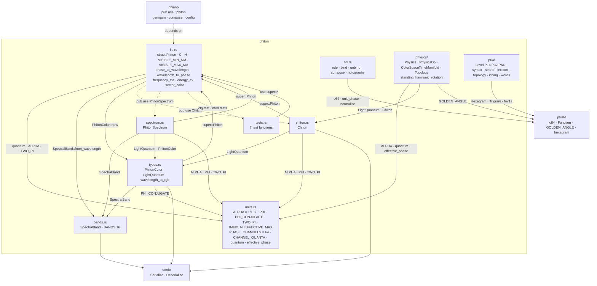
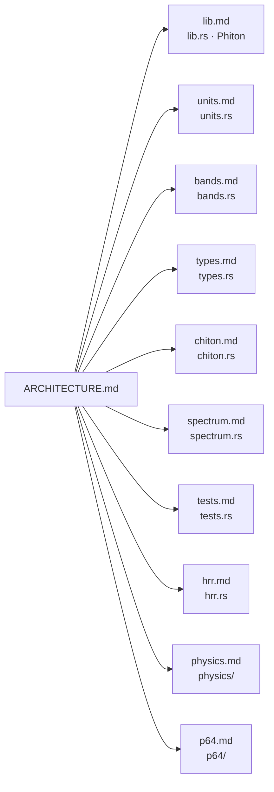

# phiton — architecture

## The crate, module by module

## The module pages

| diagram | file |
|---|---|
| Phiton · phase to light | [docs/phiton/lib.md](../../docs/phiton/lib.md) |
| the constants and the clamp | [docs/phiton/units.md](../../docs/phiton/units.md) |
| the 16 spectral bands | [docs/phiton/bands.md](../../docs/phiton/bands.md) |
| colour and quantum | [docs/phiton/types.md](../../docs/phiton/types.md) |
| the wave | [docs/phiton/chiton.md](../../docs/phiton/chiton.md) |
| the spectrum mapper | [docs/phiton/spectrum.md](../../docs/phiton/spectrum.md) |
| the tests | [docs/phiton/tests.md](../../docs/phiton/tests.md) |
| holographic binding | [docs/phiton/hrr.md](../../docs/phiton/hrr.md) |
| colour, space and time · standing waves | [docs/phiton/physics.md](../../docs/phiton/physics.md) |
| the 16/32/64 variation engine | [docs/phiton/p64.md](../../docs/phiton/p64.md) |

## Status

2026-10-27 · 24 test functions · what is left: [TODO.md](TODO.md)
