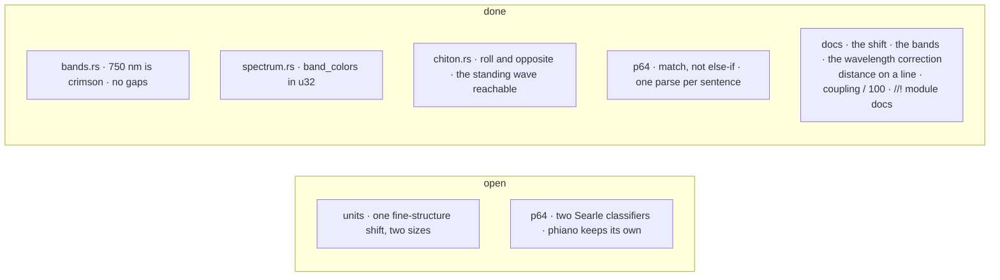

# phiton — TODO

## lib
- [x] The crate doc's diagram shifts by `quantum(band_n)·α·10` nm, as the code does; the module docs are `//!` now, so each documents its module, not the next item.

## units
- [ ] One shift, two sizes: `effective_phase` turns the phase by `quantum(n)·α` (≈ `quantum(n)·α·58.9` nm once read as colour); `Phiton::phase_to_wavelength` moves the wavelength by `quantum(n)·α·10` nm. Pick one; phiano's numbers move with it.
- [ ] phiano `server/routes/infinity.rs` computes `phase + band_n·α` inline, unclamped: it should call `effective_phase`.

## bands
- [x] `from_wavelength(750.0)` and `index_of(750.0)` fell back to `BANDS[0]` violet; the top edge now belongs to crimson, and the bands are tested gap-free.
- [x] The band docs say the bands cover [380, 750] nm without gaps and give the two narrow ones.

## types
- [x] `LightQuantum`'s doc says the correction lands on the wavelength.

## chiton
- [x] `Chiton::roll` builds the particle's ↻ wave and `opposite` flips a spin, so `resonance`'s opposite-spin weight — the standing wave the module describes — is reachable; tested.

## spectrum
- [x] `band_colors` multiplied in u16 and overflowed above 4,369 sectors; it works in u32 now, tested up to `u16::MAX`.
- [x] `spectral_distance`'s doc says `|λa − λb|` on a line, not a circle.
- [x] `coupling`'s doc formula has the `/ 100`.

## conjugate
- [x] phical's phase-conjugate mirror (`Mirror`, `Told`, `Moment`) moved here, beside `chiton`, by the user's decision; its decoy draw is `phistd::decoy`.

## p64
- [x] `SpeechAct::classify`, `ParagraphType`'s and `SentenceType`'s base types were `else if` ladders; they are `match` now, same order, same answers (an empty paragraph is still mixed).
- [x] `SearleClassifier::classify_full` parsed the sentence four times; it parses once.
- [ ] phiano `cognitive/speech.rs` keeps a second Searle classifier (`SpeechActType`, marker lists read from file) beside `p64::SpeechAct` (read from the syntax key). One Searle: decide whether the markers join p64 or the two stay as two readings.

## tests
- nothing open found in the code
