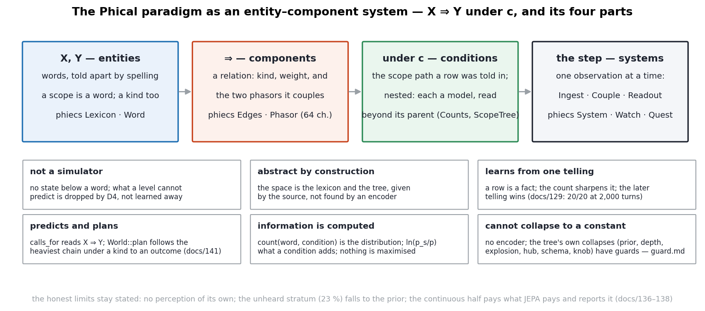
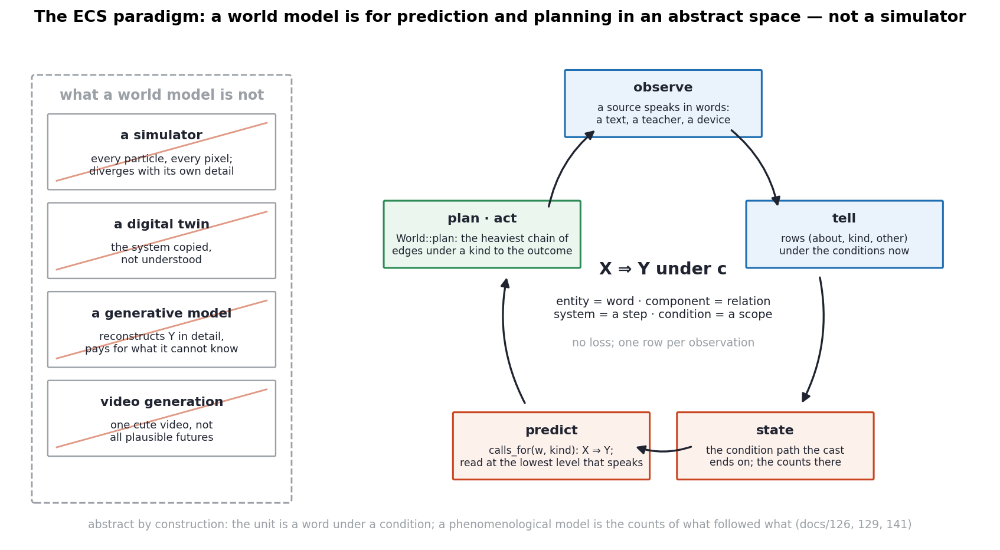
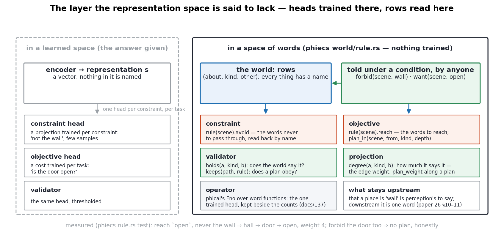
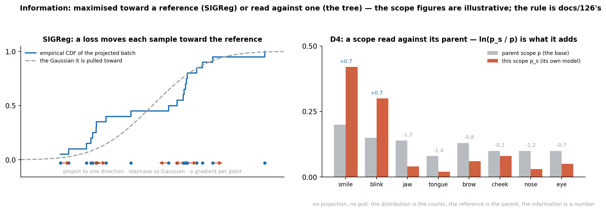
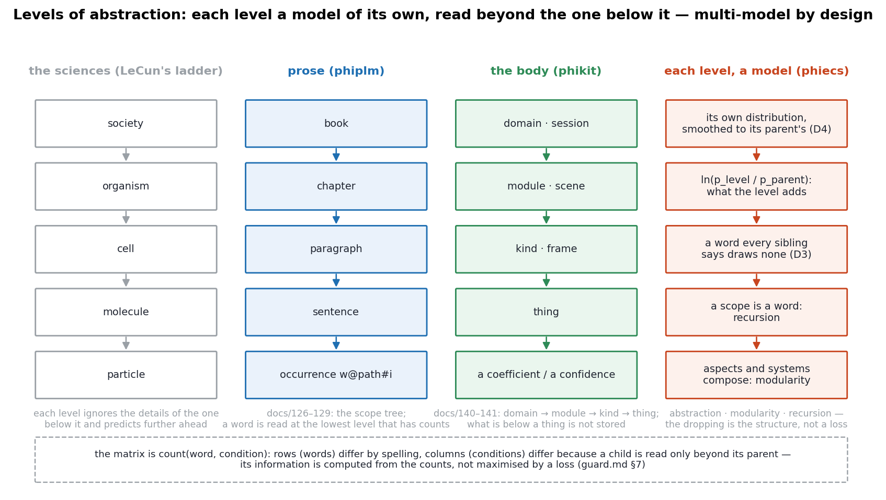

# The ECS paradigm — a world model that is not a simulator

In Phient's world, a word (w) is a seed: what it relates to, under what conditions (c), grows from it. The Phical paradigm, X ⇒ Y, drives and composes Phient's Phasor Language Models: Phinet, Phiano, PhiTon. Phical stores no point: a word is 32–64 relations, each a complex phasor on a closed circle with a count; meaning is a side effect of pairs of words moving under a condition.

This is the paradigm stated in one place, with its diagrams, in the terms the world-model argument uses (LeCun, as relayed: a world model is a phenomenological model of a system and its environment, for prediction and for planning the sequence of actions that reaches an outcome; it should work in an abstract space; it should not be a simulator, a digital twin, a generative model or a video generator). The companion documents are `training.md` (the steps), `guard.md` (what it must not do), `ecs_vs_jepa.md` (the comparison), `world_model.md` (phiecs and phinet drawn; the levels). The paper is `crates/phiano/docs/papers/26_THE_WORLD_MODEL_AS_A_TREE_OF_CONDITIONS.md`.

## 1. The paradigm in four parts



X ⇒ Y under c is an entity–component system. **X and Y are entities** — words, told apart by spelling; a scope is a word and a kind is a word, so conditions and relations are entities too (recursion). **⇒ is a component** — a relation of a kind with a weight, and the two phasors it couples: sixty-four channels per word, an angle and an evidence count on each. **c is a condition** — the scope path a row was told in, nested, each scope a model of its own read beyond its parent. **The step is a system** — one observation at a time, Ingest → Couple → Readout. Nothing else is stored; nothing is minimised.

### Where the learned information is

The entity–component system is an abstraction space, a modular space and a recursive space at once, and what is learned is not stated in it anywhere. There is no line that says *a smile is followed by a blink*. There is an edge of kind `before` with a weight of twelve, two angles on that channel that have moved toward each other, an evidence count, and a scope under which the frames were told — spread across the entity (the words in the lexicon), the component (the relation and its phasor), the system (the step that coupled them) and the condition (the scene). The knowledge is in the interplay, implicit, the way meaning in the paradigm's own sentence is a side effect of pairs of words moving under a condition. What distinguishes this from knowledge held in a network's weights — also implicit — is that every piece of it can be read back by name: `calls_for(smile, before)` lists the blink and its weight; `agreement(smile, blink, before)` gives the angle; the counts under the scene give the distribution; `plan` gives the chain. Implicit, yet surveyable (Wittgenstein §122, D15 in papers 19–23): nothing is stated, and nothing is hidden.

## 2. What a world model is for, and what this one does



A world model is for prediction and planning, not for reproducing the world. The loop is: **observe** (a source speaks in words — a text, a teacher, a device), **tell** (rows under the conditions now), **state** (the condition path a cast ends on, and the counts there), **predict** (`calls_for(w, kind)`: X ⇒ Y, read at the lowest level that speaks), **plan and act** (`World::plan(from, kind, to, depth)`: the heaviest chain of edges under a kind to the outcome — optimal control's question, answered from the edges alone). Measured in the smallest case (docs/141, `cargo run -p phikit --example watch -- 12`): a world shown a smile followed by a blink and a yawn followed by the tongue plans `mouth smile left → eye blink right` and `jaw open → tongue out`, and answers *none shown* for `smile → tongue`, which it never saw follow.

It is **not a simulator** because it holds no state below a word: a tracked face enters as the sentence of the shapes it is sure of, not as fifty-two floats, and never as pixels. It is **abstract by construction** because its representation space is the lexicon and the tree, given by the source rather than found by an encoder. It is **phenomenological** in exactly the sense asked for: the model of a system is the counts of what followed what under which conditions, with no equations of the system written down — the body's expressions are what the face was seen to do, the registry's services what matched what.

### Observation before reward; constraints in the words

The talk ends by asking that reinforcement learning be minimised — learn by observation, use reward only on top of good representations — and, in its last question, how an engineer states a constraint ("don't hit the wall") or an objective ("the door is open") in a learned representation space; the answer given is a small head trained per constraint. The tree is observation-first to the end: no reward anywhere, one row per telling, and the measure kept is tellings-to-find. And in a space of words no head is trained for a constraint, because the constraint is a word: `World::plan_avoiding(from, kind, to, depth, avoid)` finds the heaviest chain under a kind that reaches the objective without passing through the words to avoid — tested on two roads, the lighter taken when the heavier is forbidden, and *no plan* answered when every road runs through the forbidden word. The cost function is the edge weights the world was shown. The layer the speaker said must be trained — projections, validators, constraints — exists here as a reading of the rows (`phiecs::world::rule`, figure below): `forbid(scene, wall)` and `want(scene, open)` are rows of the kinds `avoid` and `reach`; `rule(scene)` reads them back; `holds(a, kind, b)` is the validator, `degree(a, kind, b)` the projection (the edge weight — the controller's cost), `plan_in(scene, from, kind, depth)` the plan under both; the one trained head Phient has is phical's operator, kept beside the counts. Tested: reach `open`, never the wall ⇒ `hall → door → open` (weight 4); forbid the door too ⇒ no plan. What a wall is in a continuous space is upstream of the tree (perception, §6); downstream, it is one word.



## 3. Information measured, not maximised



The joint-embedding programme needs its representation to be informative and cannot measure information from a batch of points, so it regularises: SIGReg projects the batch to a direction, compares the empirical cumulative distribution (a staircase) with a Gaussian's, and moves every point toward where the Gaussian would have it — an isotropic Gaussian being the distribution in which the variables are independent. That is a loss pulling samples toward a reference.

The tree has the distribution: `count(word, condition)` over finite sets. Its reference is the parent scope's distribution (D4), and what a scope *adds* is `ln(p_s / p)` per word — read, not pulled. A word every sibling says adds nothing (D3). The two ways of making a matrix informative — rows different, columns different — are met by construction: words differ by spelling; conditions differ because a child column is read only beyond its parent's. The strata of docs/137 (77 % of held-out positions heard, 23 % unheard) are the measured information that was and was not there. Nothing is projected and nothing is pulled; where the system does use a continuous summary (the field, the coupled phasors, phical's operator trained by a hinge against a sampled decoy — a sample-contrastive criterion) it is kept beside the counts and measured against them.

## 4. The levels are models



The levels-of-abstraction argument — particles, molecules, cells, organisms, societies; Navier–Stokes rather than molecules — says a model must choose a level and drop what is below it. In the tree the levels are the conditions the source was told under, and each is a model of its own: a distribution over what was said there, nested in its parent's, read at the lowest level that has counts. The system is multi-model by design. What phiecs contributes is **abstraction** (a level is an entity), **modularity** (aspects and systems compose; the crates stack one way), and **recursion** (scopes within scopes; answers become sources; the world's phasors seed the field).

## 5. What must not happen

A counting tree has no encoder to collapse to a constant, but it has collapses of its own, each met and guarded (guard.md): the **prior** (the biggest scope wins — locality and the nested base), **depth** (the deepest path wins — one scope per thing), **explosion** (every occurrence a scope — the store reported with the accuracy, 2.8 KB a word), the **hub** (every angle meets — evidence kept; silence is not agreement; hubs are conditions; not yet measured on a corpus), **schema** (our prior in the tree — nothing hard-coded, a name is its words), and the **knob** (a heuristic beside the base — build on the base, measure, revert).

## 6. Where the comparison is honest

The tree does not perceive; it begins where something already speaks in words. A JEPA encoder is a candidate front end to it, and the tree a candidate world model behind one — the place its representations could be told as words under conditions, counted, planned over, and have their information read exactly. The unheard stratum falls to the prior; the continuous half pays what JEPA pays and reports it (docs/136–138).

```
observe ─▶ tell rows under c ─▶ count (D1 · D2 · D4) ─▶ relate (phasors couple) ─▶ cast (D3) ─▶ read at a level ─▶ plan (chains under a kind) ─▶ act ─▶ observe
```

`python3 docs/figs_world.py` · `cargo test -p phiecs plan` · `cargo run -p phikit --example watch -- 12`
