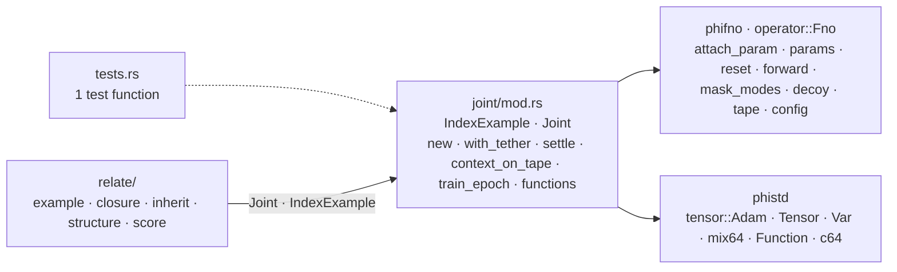
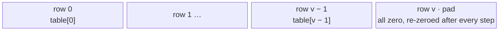
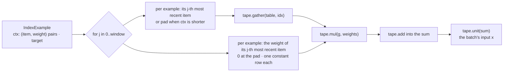
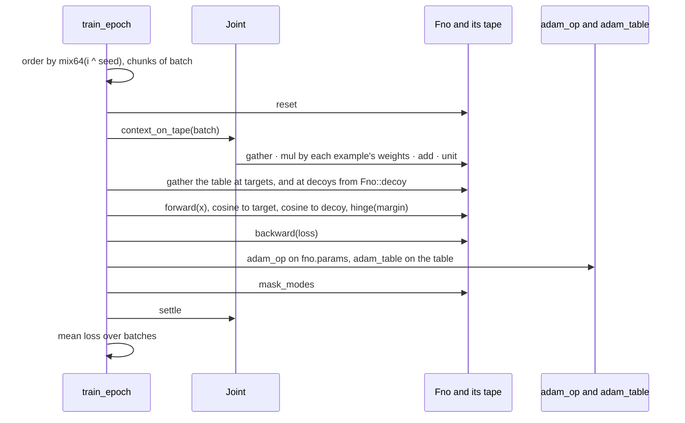
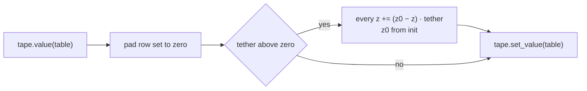
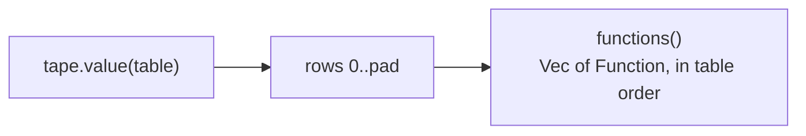
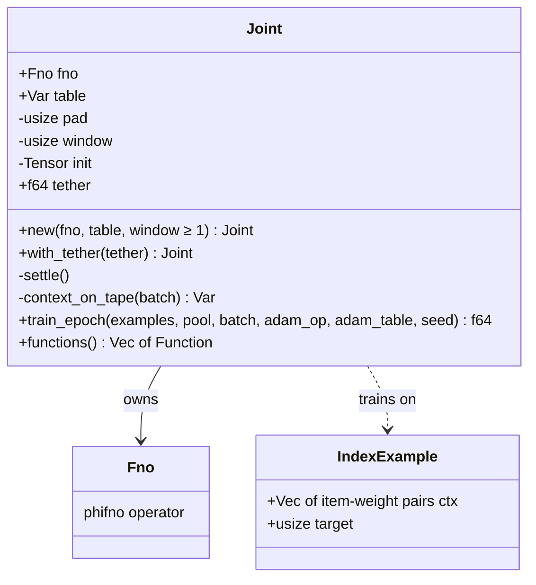

# joint

## Files

## The table on the tape — Tensor [v + 1, 1, space], fno.attach_param

## A batch's context, built on the tape

## One batch of train_epoch

## settle

## Reading it back

## The types

