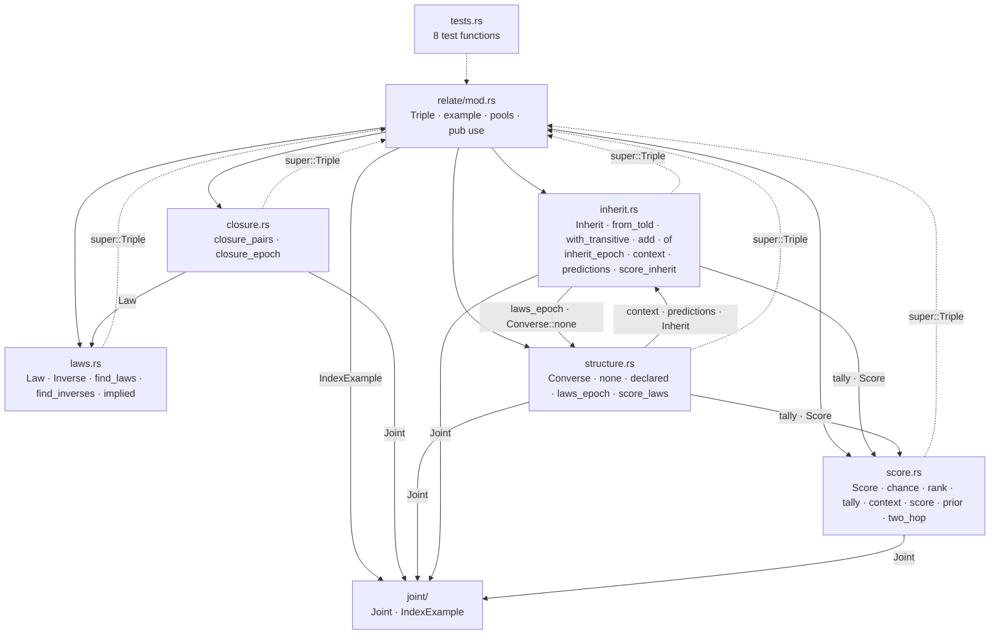
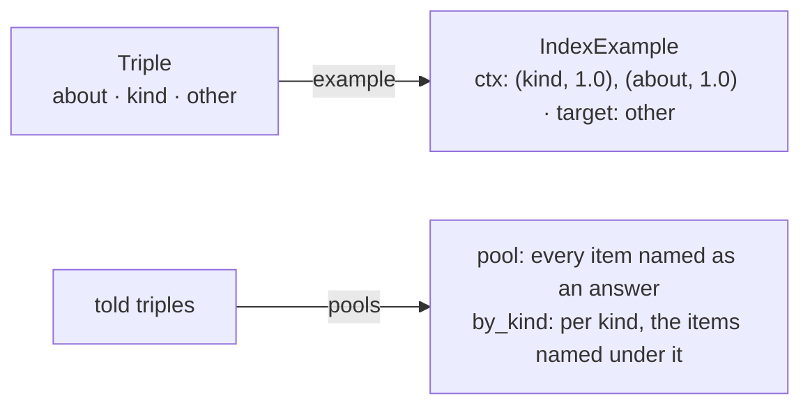
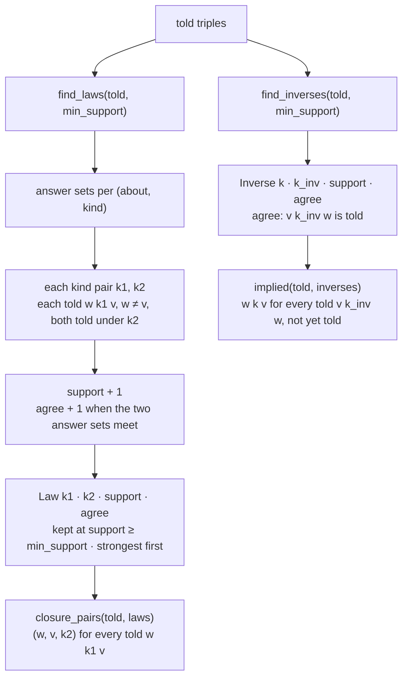
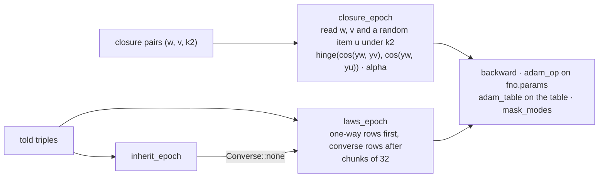
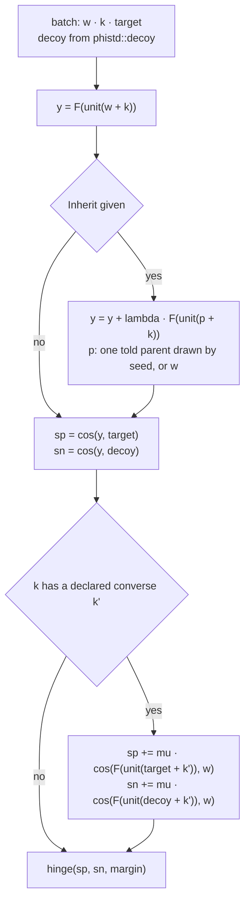
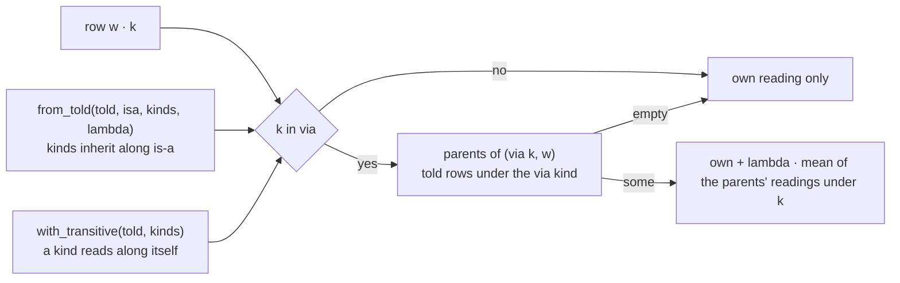
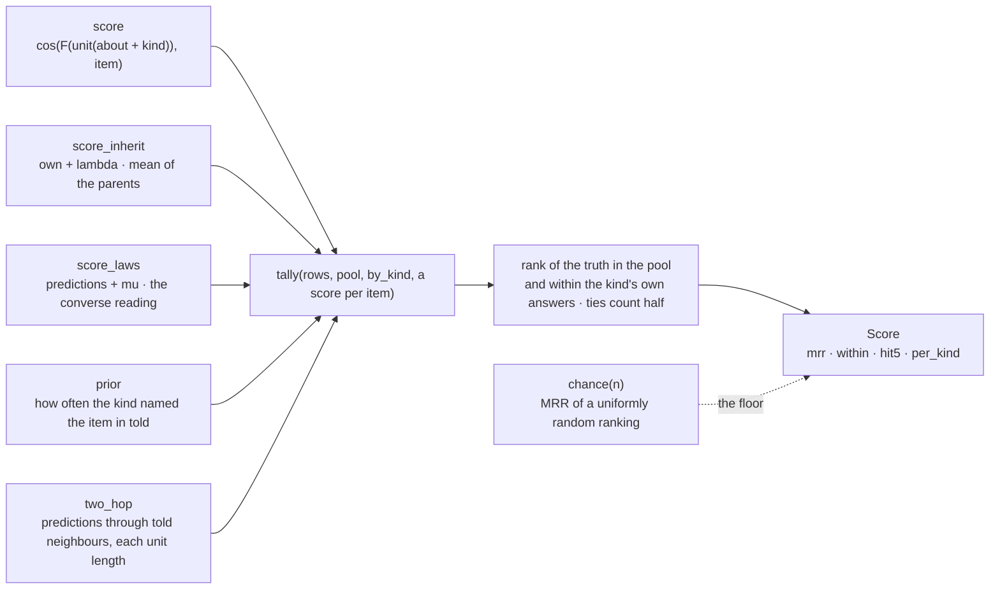
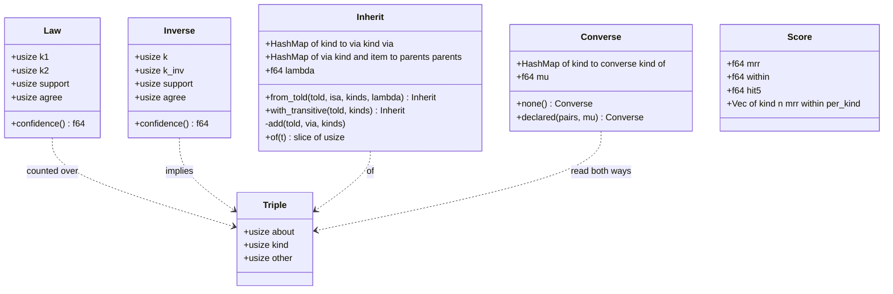

# relate

## Files

## A triple becomes an example

## Laws, counted not written

## Three ways to train the Joint

## One batch of laws_epoch

## Inheritance — who reads a parent

## Reading back

## The types

