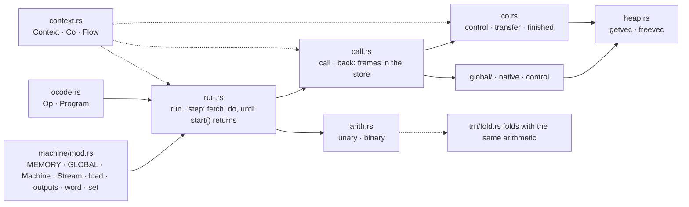
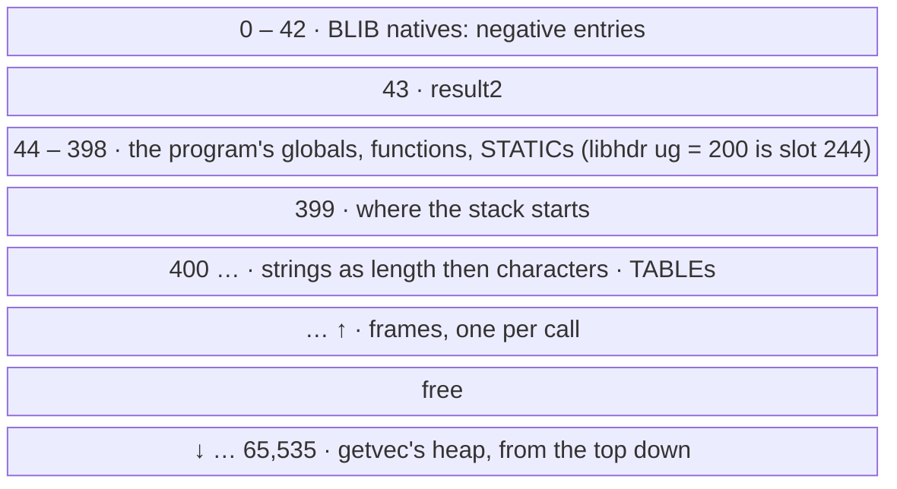
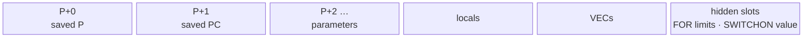
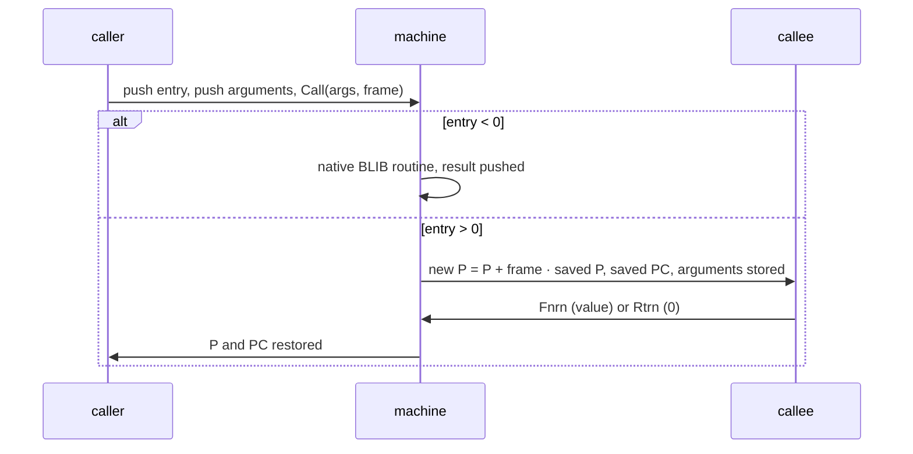
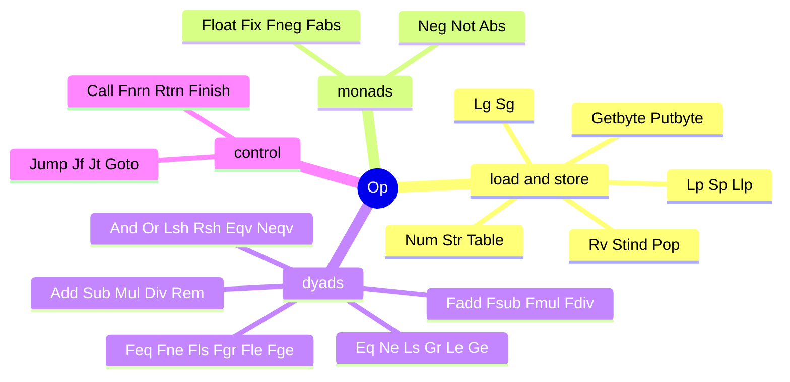
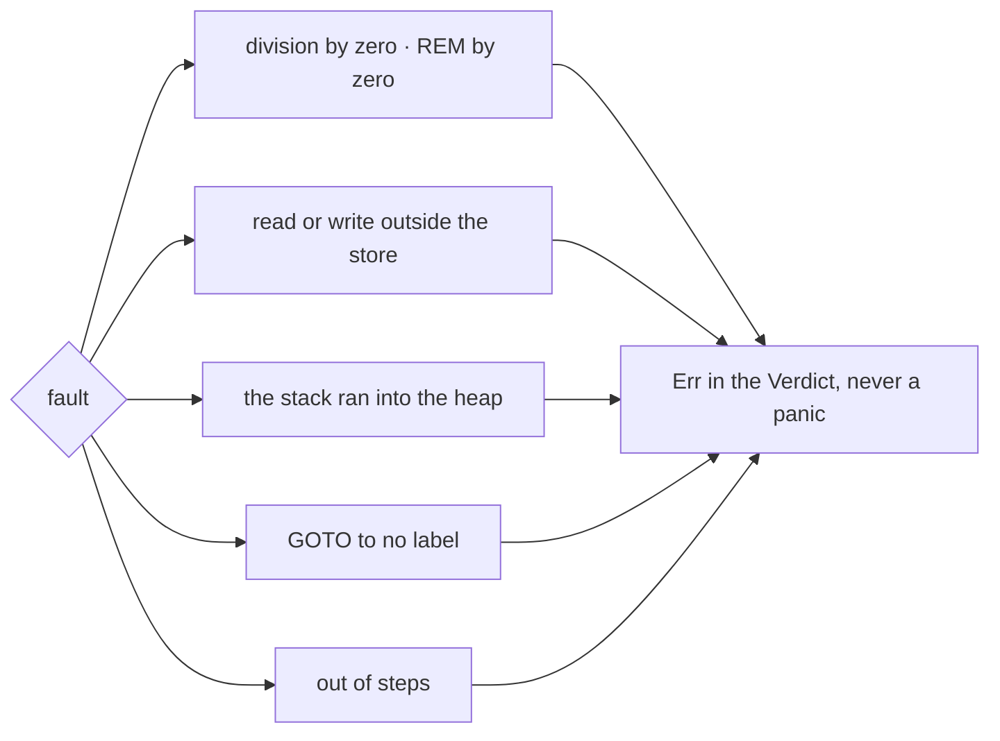
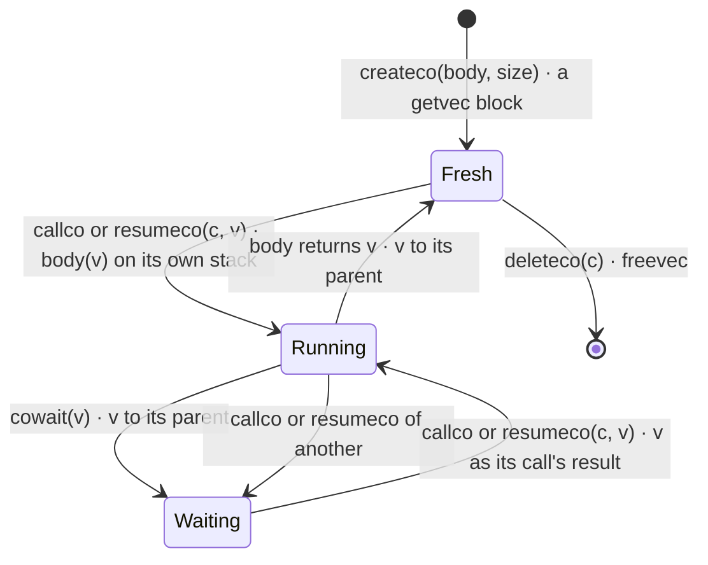
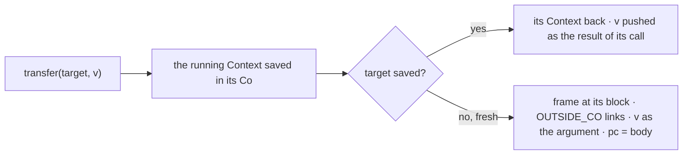
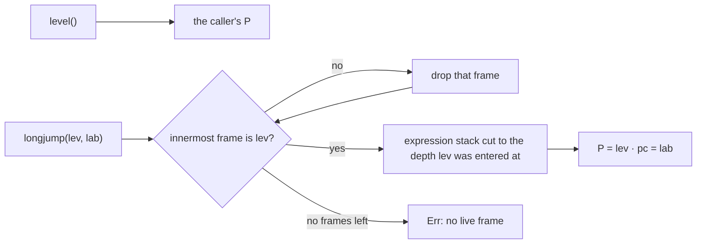

# machine · ocode

## Files

## The store — 65,536 words

## A frame at P

## A call

## The 55 ops

## Faults are verdicts

## Threads — the main program and its coroutines

## level · longjump

