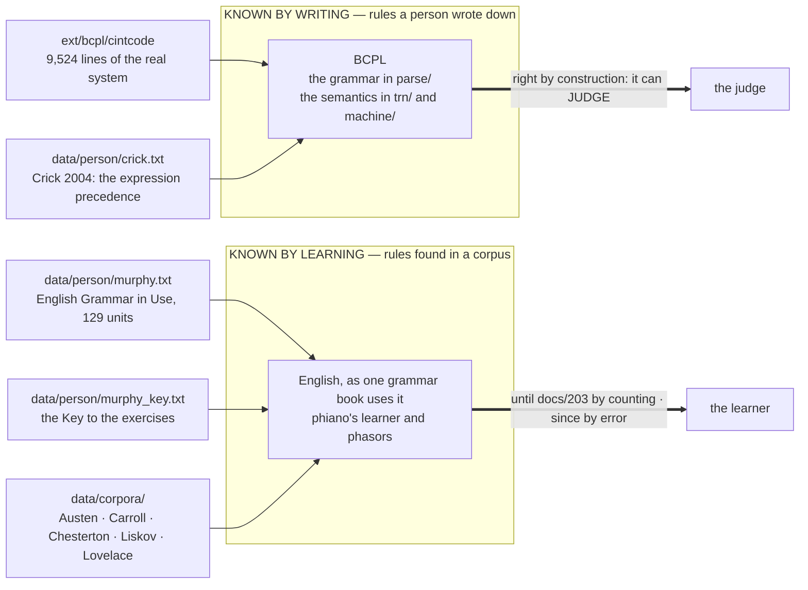
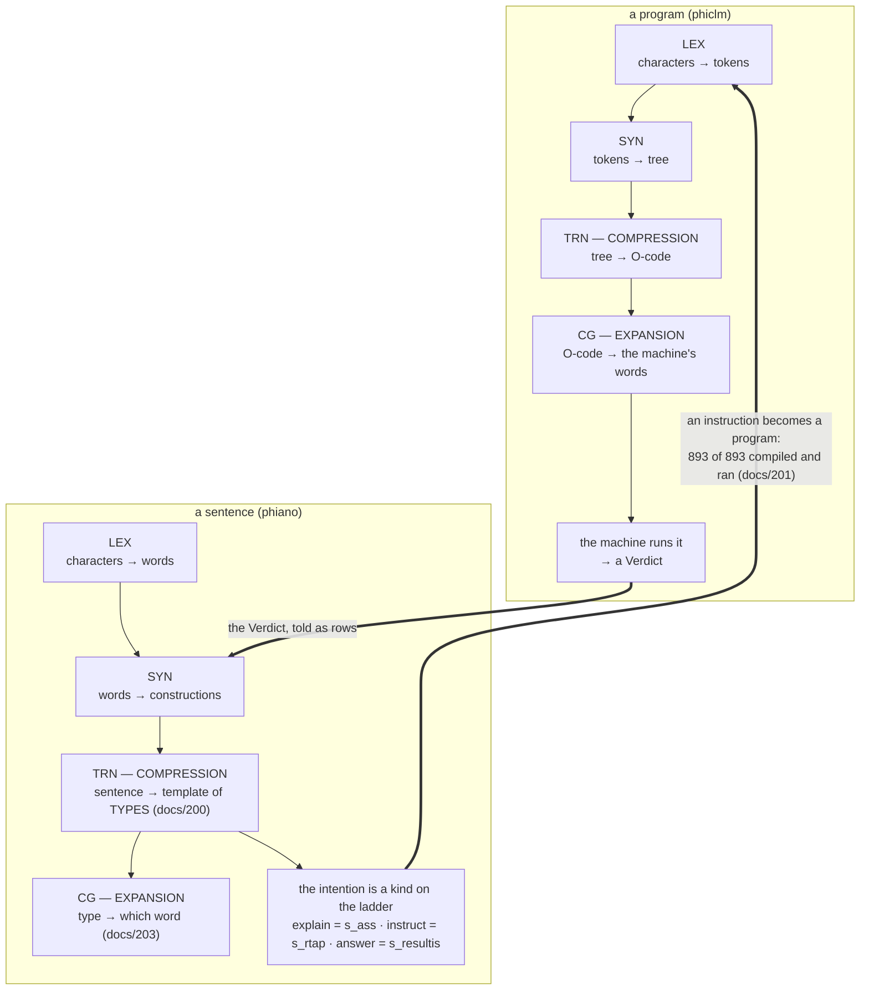
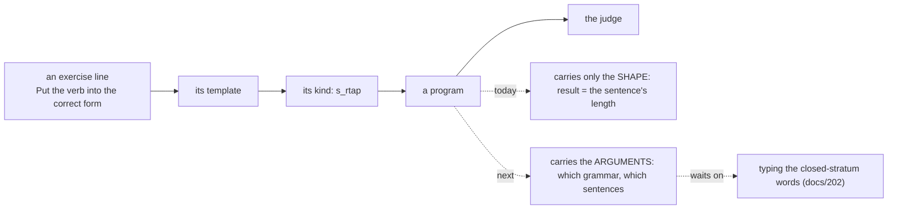

# prose and the two compilers

## Known by writing, known by learning

## Two compilers, one ladder

## The bridge, step by step

## The rules and conditions

| | in BCPL | in prose |
|---|---|---|
| vocabulary of structure | `KEYWORDS` · closed, written | `the to a is of …` · closed, learned |
| open vocabulary | names | content words |
| a rule | a production in `parse/` | a construction family · a channel |
| a condition | `IF e`, `TEST e` | the words before, each through its operator |
| a type | a manifest kind | a word's sector on the circle (docs/200) |
| ground truth | the judge | held-out sentences · the Key · the judge |
