# kit · eye

## signal · Inside signal.rs

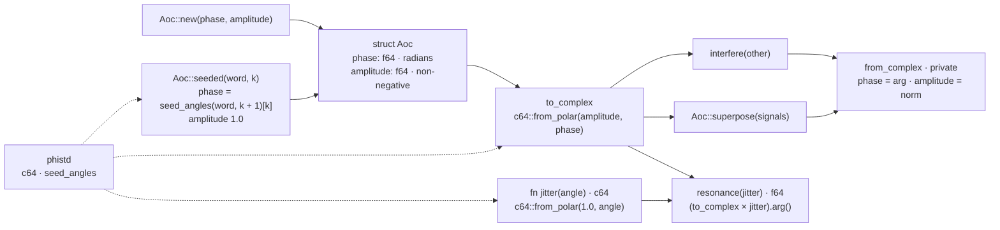

## signal · Interference — complex addition

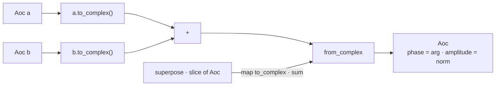

## signal · Resonance — complex multiplication

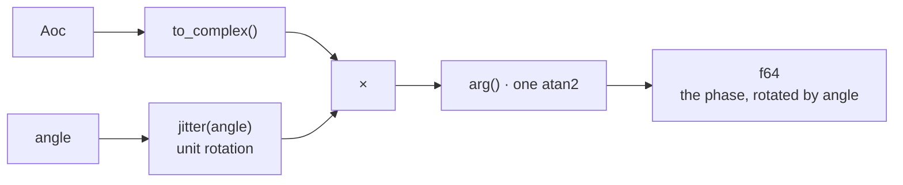

## signal · The type

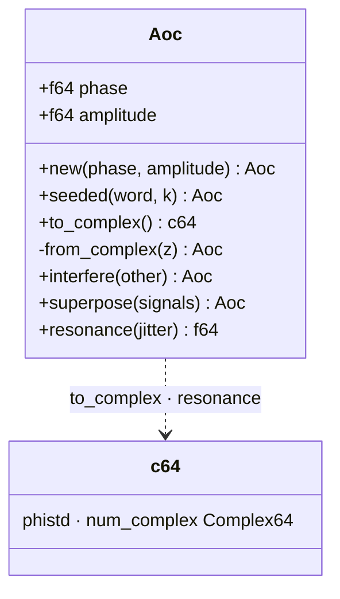

## signal · What the test pins

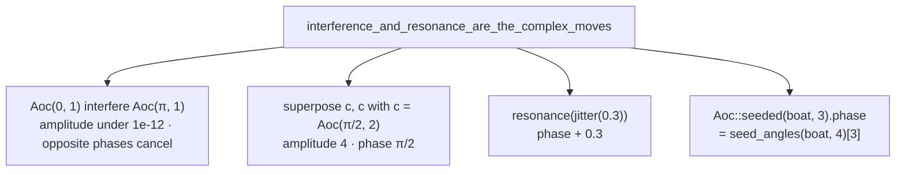

## flow · Inside flow.rs

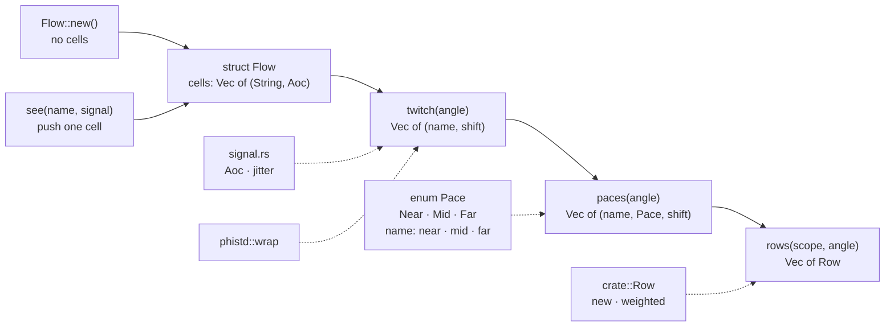

## flow · A twitch, cell by cell

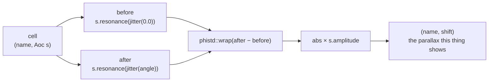

## flow · Paces — binned against the field itself

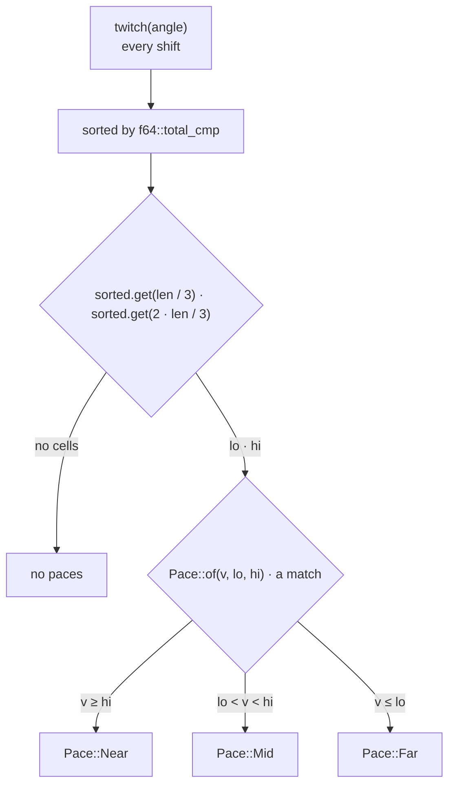

## flow · Told as rows

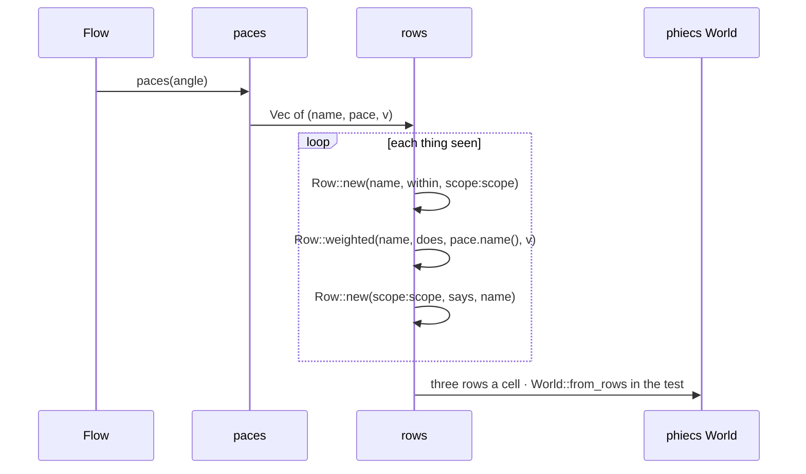

## flow · The types

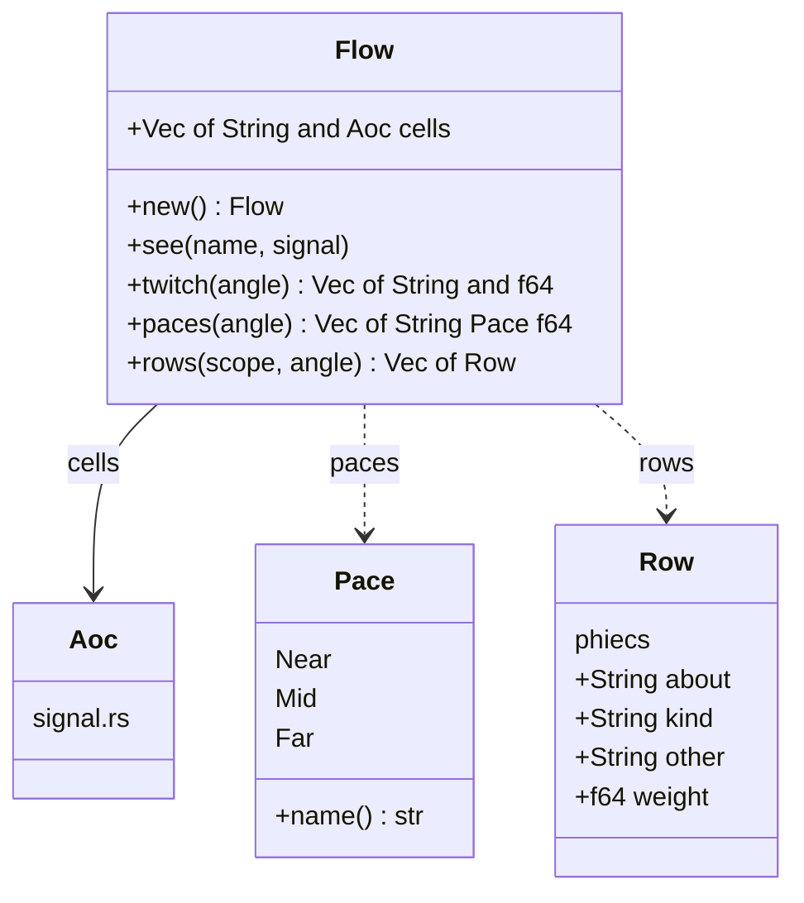

## flow · What the test pins

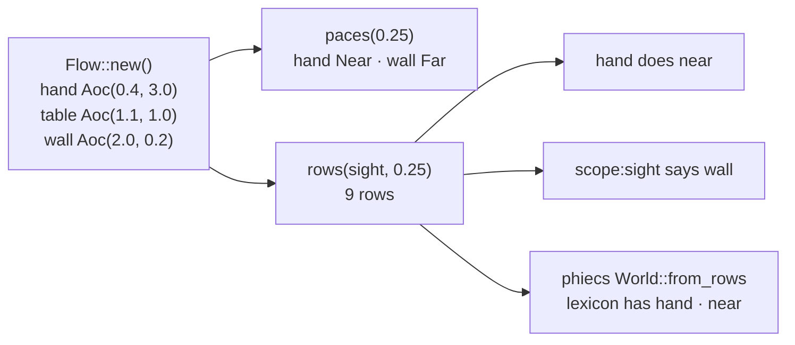
