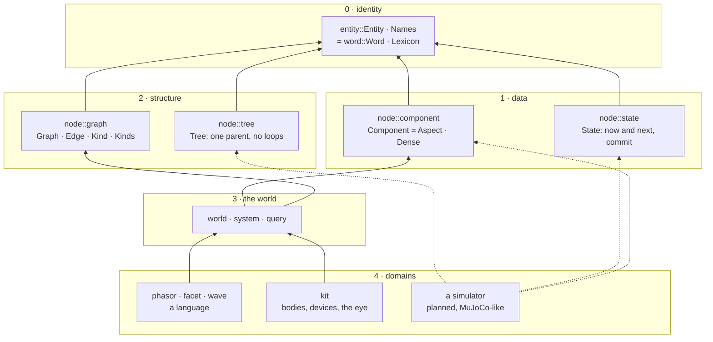
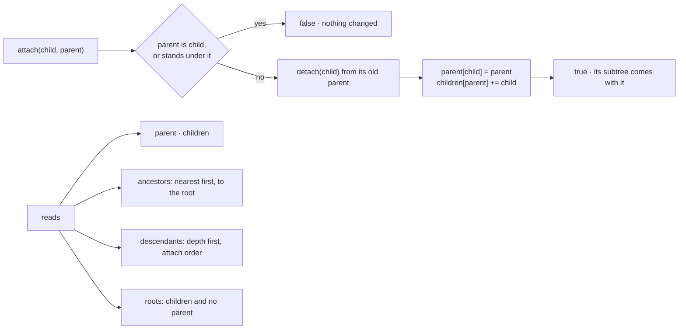
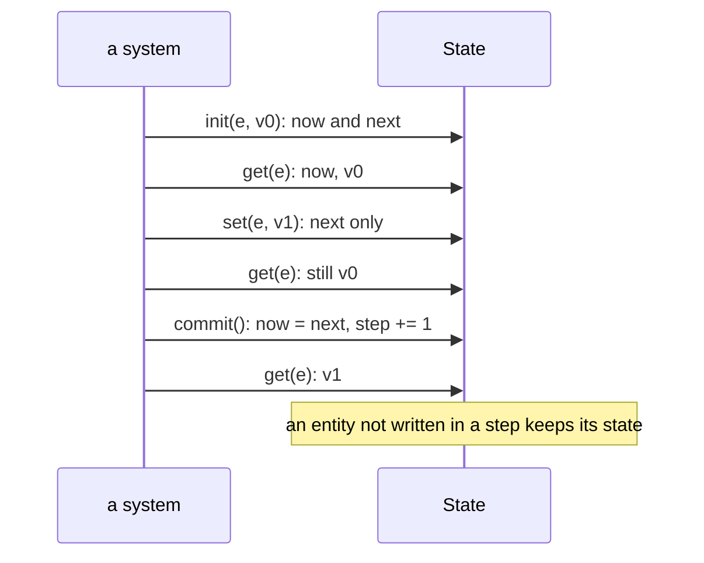

# entity · node

`entity` is level 0 of phiecs; `node` holds levels 1 and 2. `Entity`,
`Names`, `Component`, `Dense`, `Graph`, `Edge`, `Kind` and `Kinds` are the
ECS names of `Word`, `Lexicon`, `Aspect`, `Dense`, `relation::Graph`,
`Edge`, `Relation` and `Register`; `Tree` and `State` are new.

## The levels

## Tree

## State

