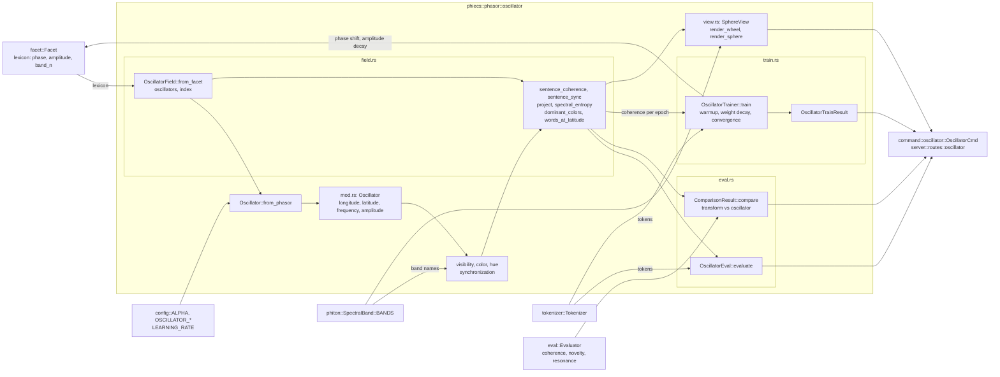

# phasor · oscillator

`phiecs::phasor::oscillator` — it was phiano's `oscillator`. The sphere model itself (`Oscillator`) is `phiton::physics::oscillator`, beside Bentov's `standing`; the evaluation against the Evaluator is `phient::eval::oscillator`. The diagram shows the module as it was drawn whole.

