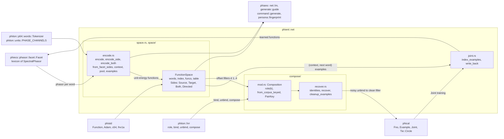
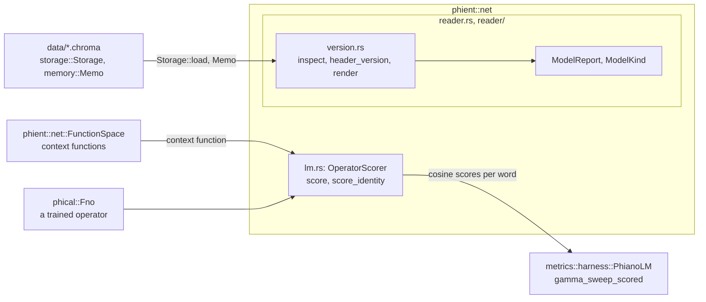

# net

`phient::net`: the lexicon read as a function space, beside the operators.
It was phiano's `phinet`; phiano keeps the model-file reader and the
perplexity scorer, which were `phiano::net`, are here too (below).

## The reader and the scorer

