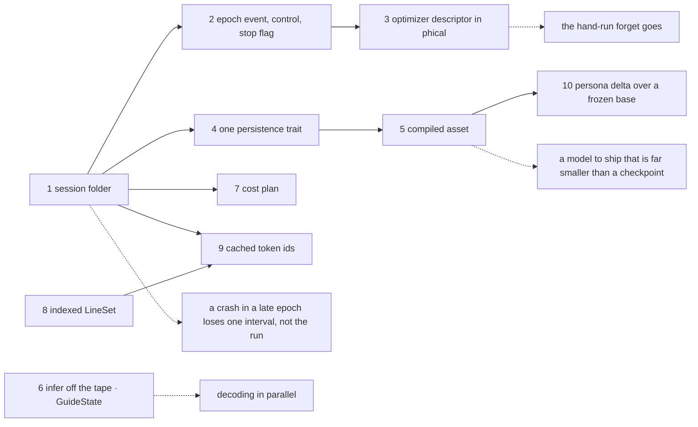
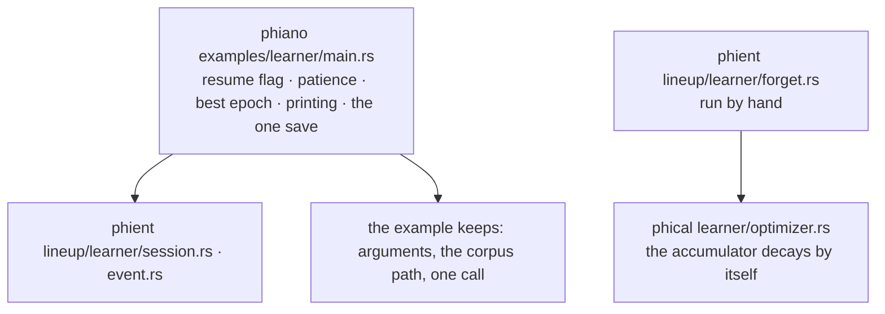

# phient — plan for the training session

The folders to add and the order to add them in, for what Apple's
machine-learning interfaces offer phient. What each part must do is in
[specs.md](specs.md); the diagrams are in [session.md](session.md); the
row-by-row reading of Apple's headers is [apple.md](apple.md). Line counts
are estimates. Nothing here was run or trained.

phient orchestrates and phical computes: arithmetic lands in phical, the
session, events and files in phient.

## Where things are today

| Path | Holds |
|---|---|
| `crates/phient/src/lineup/learner/` | the Learner: `config`, `plane`, `condition`, `step`, `train`, `read`, `reader`, `store`, `widen`, `forget`, `scratch` |
| `crates/phient/src/study/` | the protocol every model answers: `arena`, `class`, `lab`, `score`, `seam` |
| `crates/phient/src/generate/` | decoders, the guide, the persona prior |
| `crates/phiano/examples/learner/main.rs` | the run itself: resume flag, patience, best epoch, the one save |
| `crates/phical/src/q64.rs` | a phase as one of 64 symbols |
| `crates/phifno/src/operator/` | the operator, run on the training tape |
| `crates/phisor/src/machine/engine.rs` | the mill: steps numbered, the cheapest card taken |

## The files to add (suggested)

| Path | Holds | Lines | Order |
|---|---|---|---|
| `crates/phient/src/lineup/learner/session.rs` | `Session`: the folder, resume the newest, checkpoint by rename, lineage | ~200 | 1 |
| `crates/phient/src/lineup/learner/event.rs` | the epoch-end event and the control it returns | ~80 | 2 |
| `crates/phient/src/lineup/learner/train.rs` | `epoch` calls the event; a stop flag | grows by ~40 | 2 |
| `crates/phical/src/learner/optimizer.rs` | the optimizer descriptor: decaying accumulator, clipping, finite check | ~150 | 3 |
| `crates/phient/src/study/persist.rs` | one trait: encode and decode, with and without the optimizer | ~150 | 4 |
| `crates/phient/src/lineup/learner/compile.rs` | the compiled asset: planes only, a header readable alone | ~180 | 5 |
| `crates/phifno/src/operator/infer.rs` | `infer` off the tape, over the same `graph::forward` | ~120 | 6 |
| `crates/phient/src/generate/guide_state.rs` | decode state apart from the guide | ~160 | 6 |
| `crates/phient/src/lineup/learner/cost.rs` | positions and seconds a run, an estimate before the next | ~120 | 7 |
| `crates/phient/src/study/line.rs` | `LineSet`: count, indexed read, a split by content hash | ~150 | 8 |
| `crates/phient/src/lineup/learner/token.rs` | token ids cached in the session folder | ~100 | 9 |

Data, not code: the session's defaults (checkpoint interval, patience,
rate schedule) go in a file under `crates/phient/data/`, read through
`phistd::lexfile`.

## The session folder

| Entry | Holds | Written |
|---|---|---|
| `header` | lineage (the checkpoint resumed from), config, corpus hash, epoch, metrics | with every checkpoint |
| `checkpoint-<epoch>` | planes, accumulators, told lines, rng: bit-exact | every N epochs, temp name then rename |
| `token` | the corpus as token ids | once a corpus |
| `asset` | planes only, f32 or Q64 | on request |
| `record` | positions and seconds, a run a line | at the end of a run |

Older checkpoints are moved to `_temp` with an inventory, never deleted.

## Order of work

## What moves, and from where

