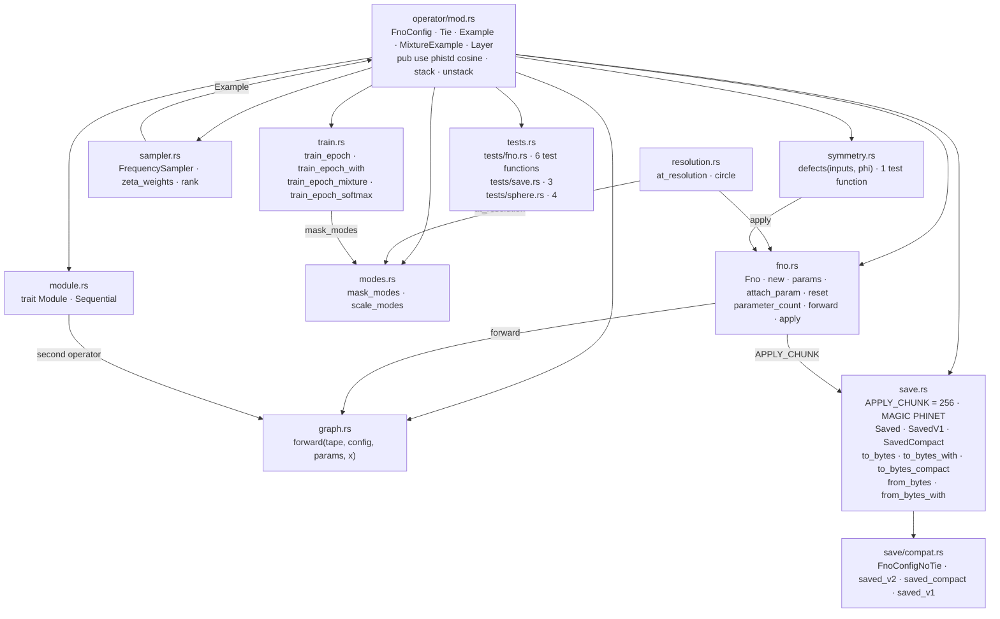
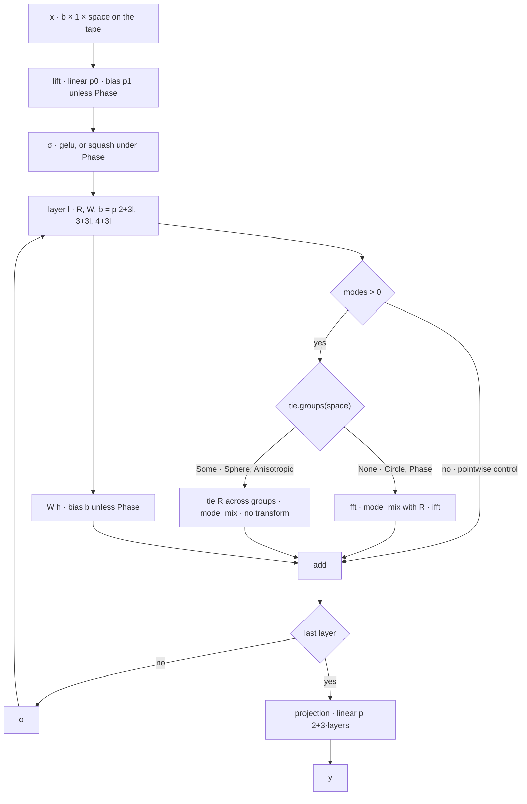
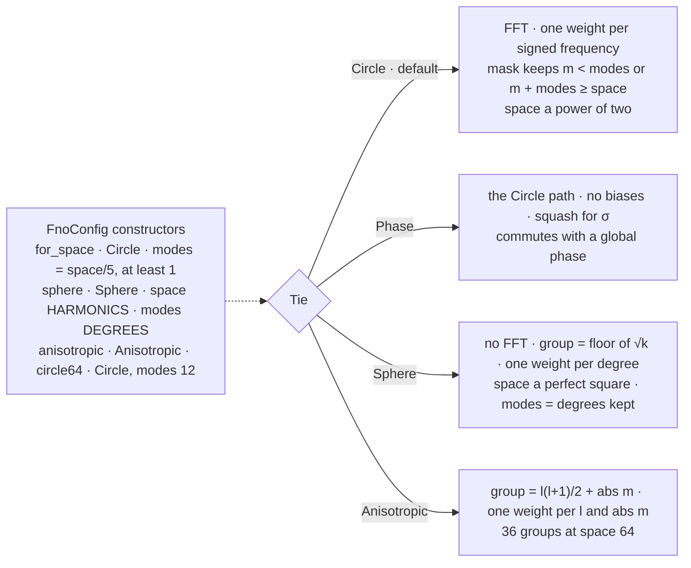
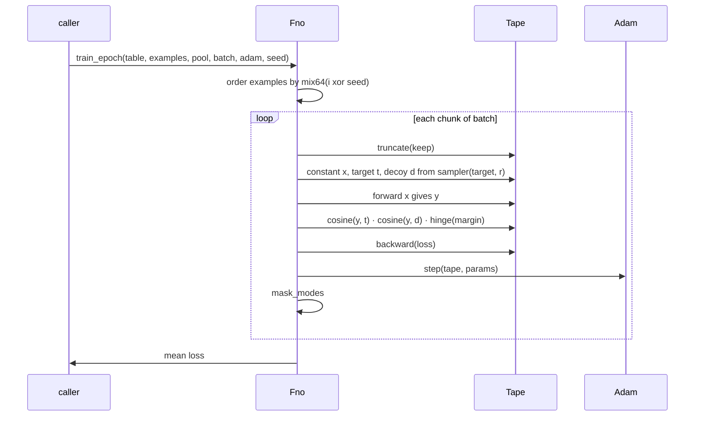
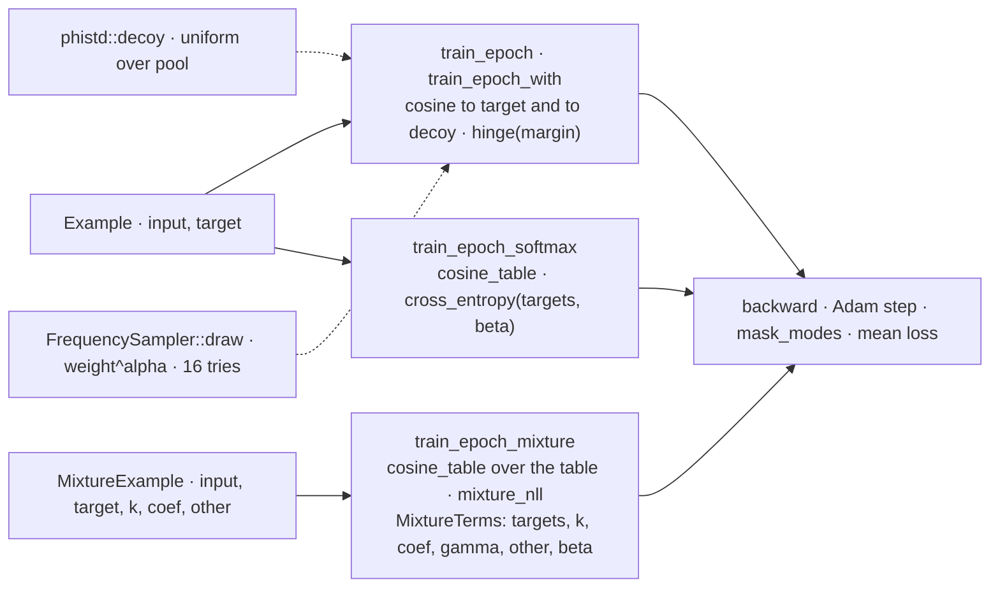
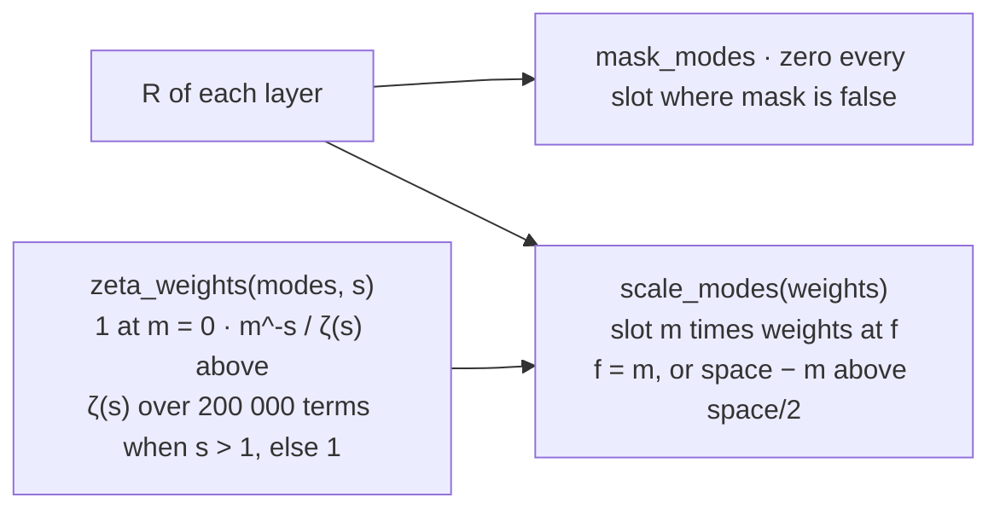
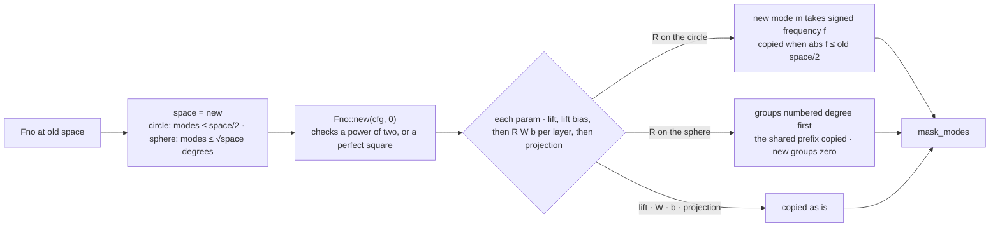
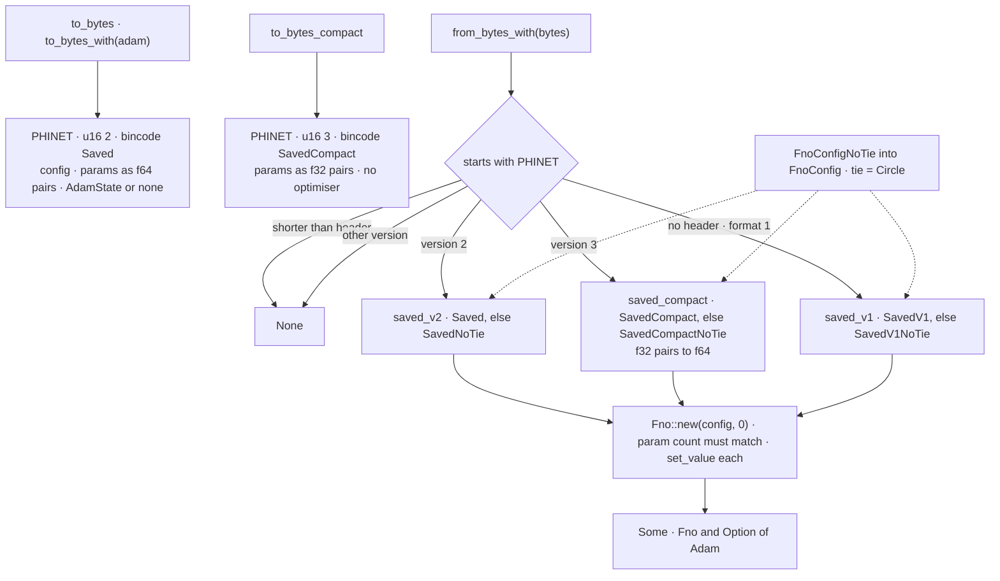
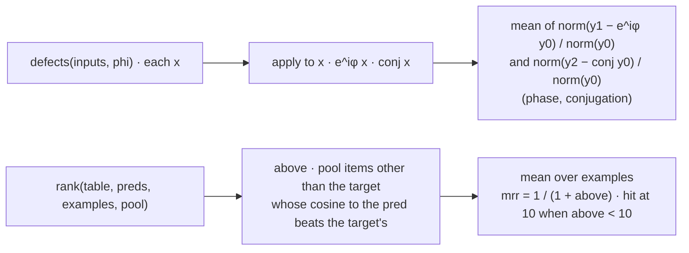
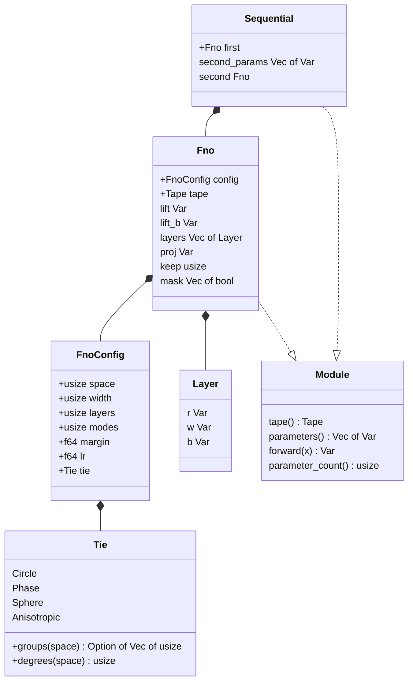

# operator

## Files

## The forward graph — h ← σ(F⁻¹(R · F(h)) + W h + b)

## Tie — what one spectral weight is shared over

## A hinge epoch — train_epoch_with

## Three epochs, three losses

## After a step — the mask and the zeta prior

## at_resolution(space)

## Saving and loading

## Symmetry defects and ranking

## The types

