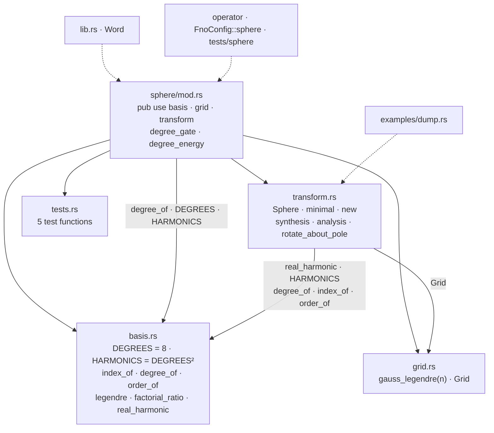
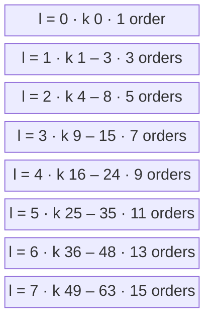
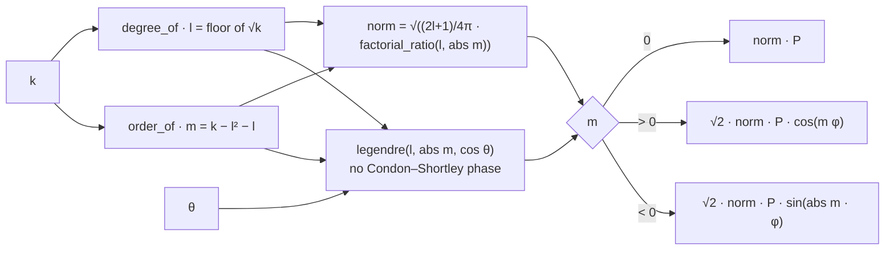
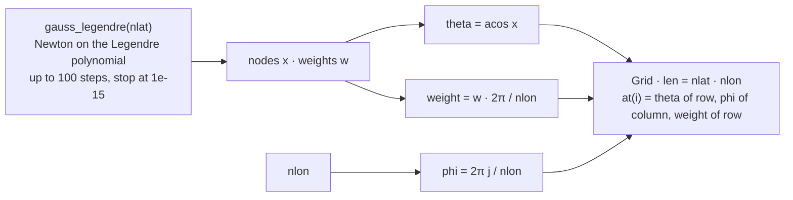
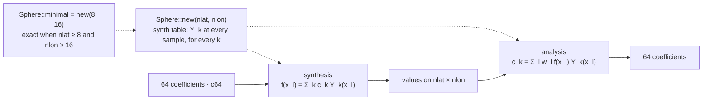
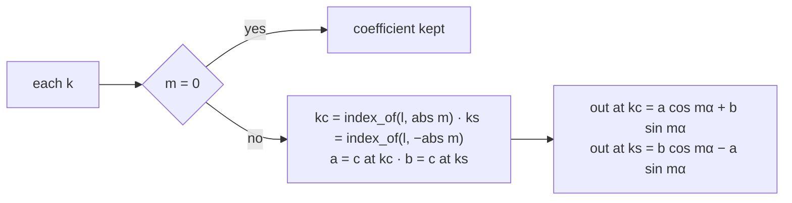
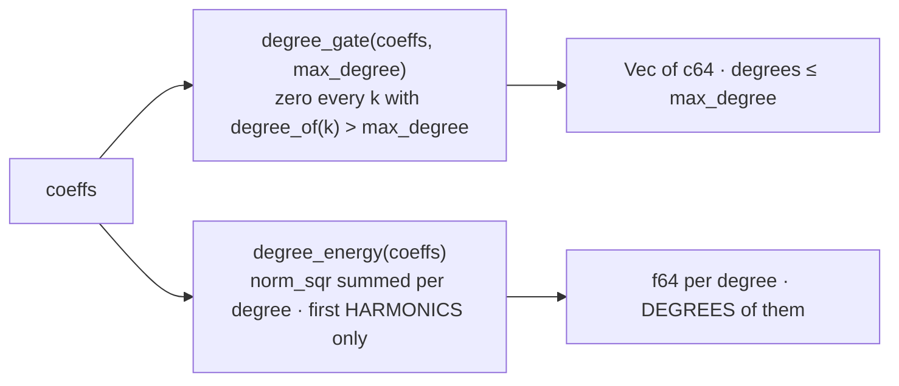
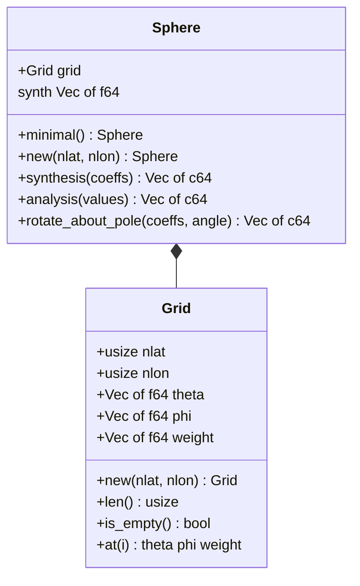
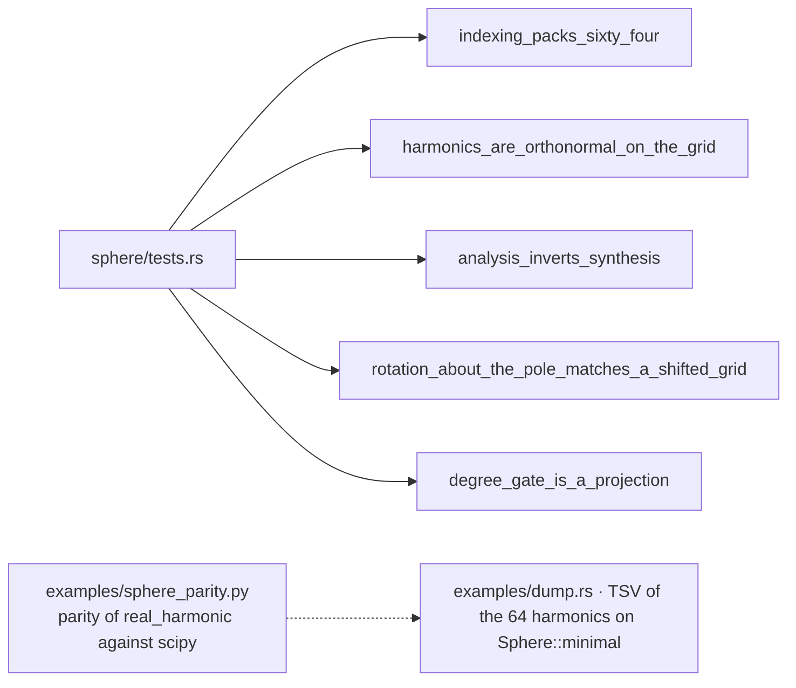

# sphere

## Files

## Channel k ↔ (l, m) — k = l² + l + m

## One harmonic at one point — real_harmonic(k, θ, φ)

## The grid — Grid::new(nlat, nlon)

## The transform pair

## Rotation about the pole — rotate_about_pole(coeffs, α)

## Resolution and scale

## The types

## The tests

