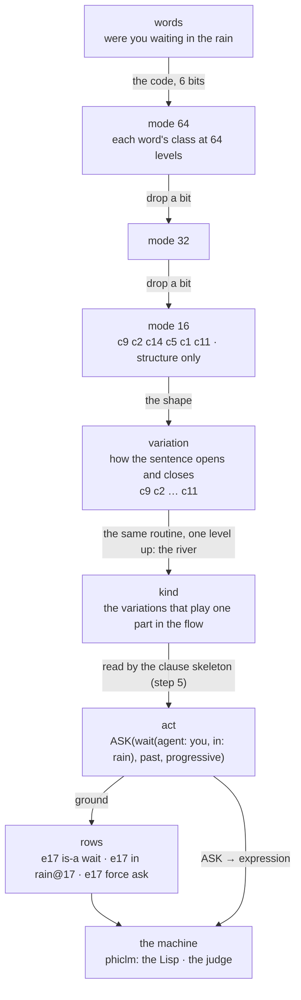
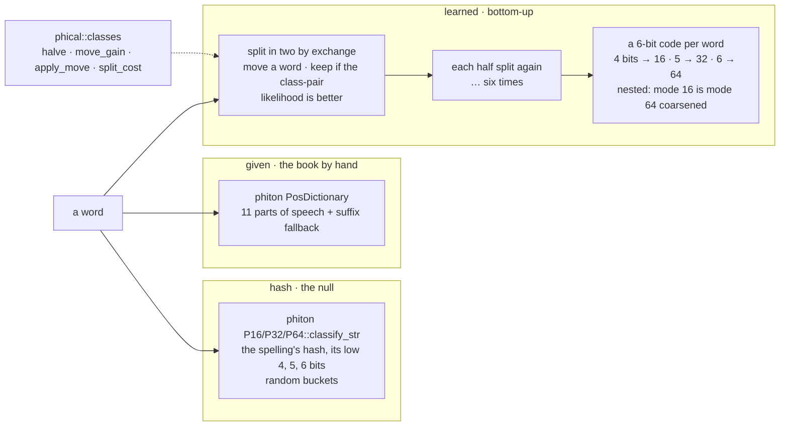
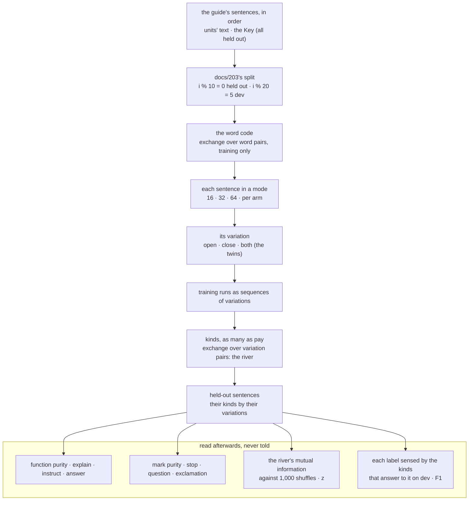
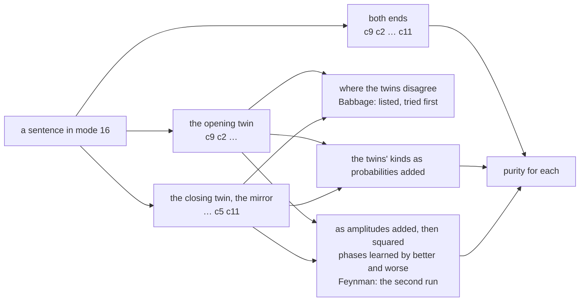
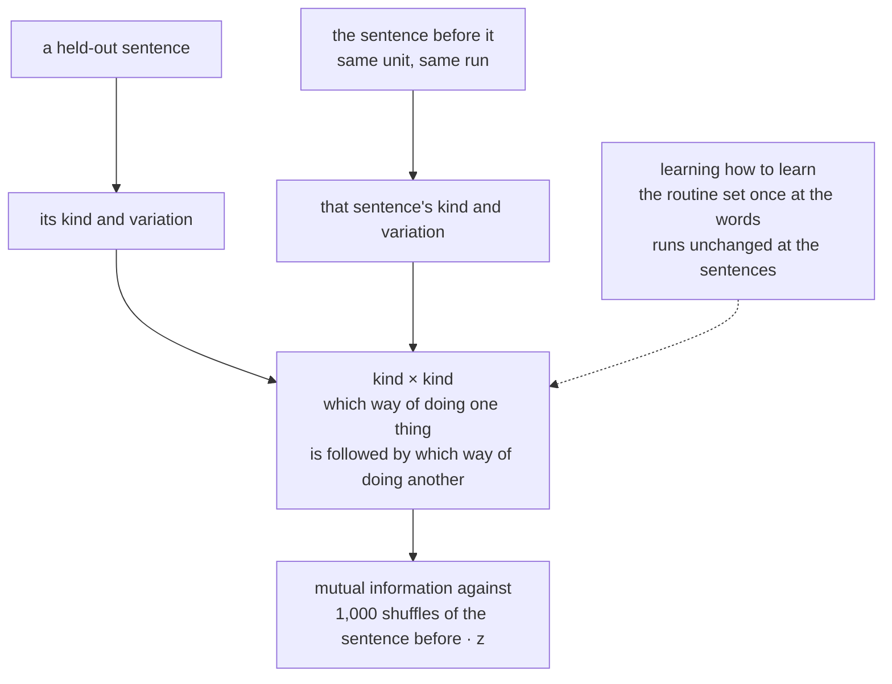
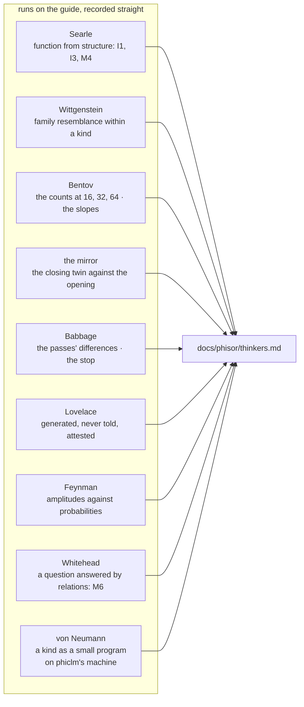
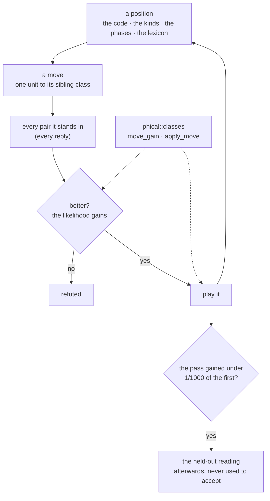
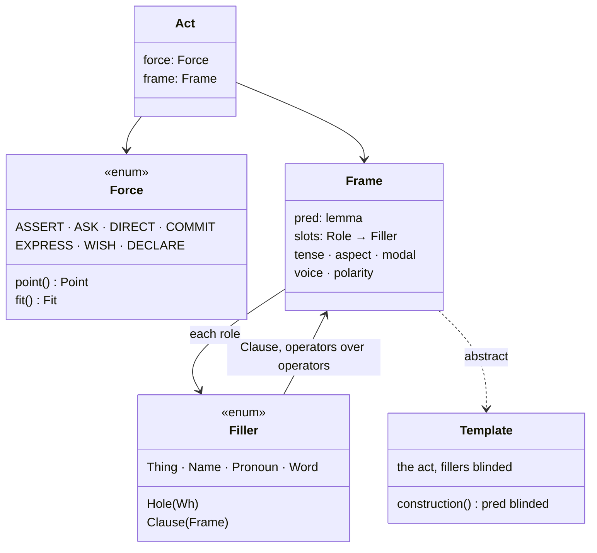
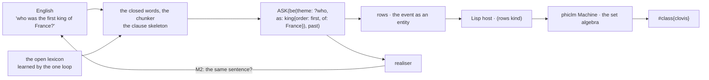
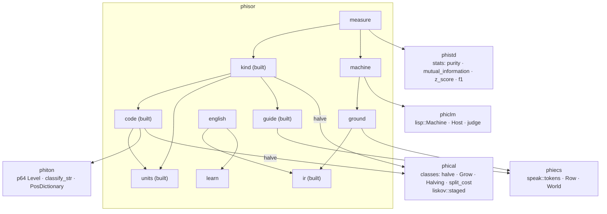

# phisor — architecture

## The ladder: one language at several heights

## The code: three arms in the same modes

## The first experiment: the kinds of intention and their variations

## The twins and the amplitudes

## How the variations relate

## The thinkers, each a small run

## The one loop

## The act, at the top

## English → the act → rows → the machine (steps 5 and 6)

## The crate and the workspace

