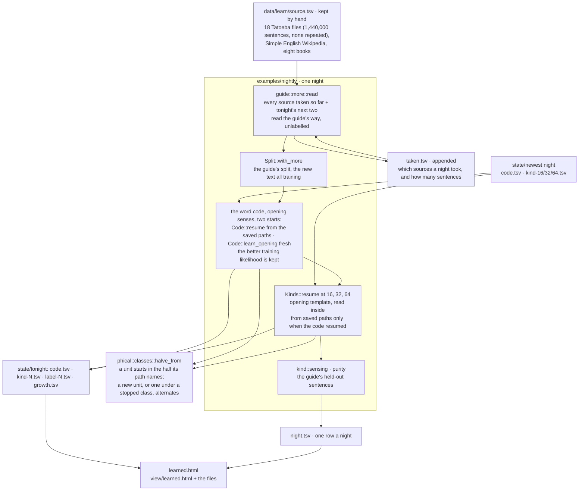
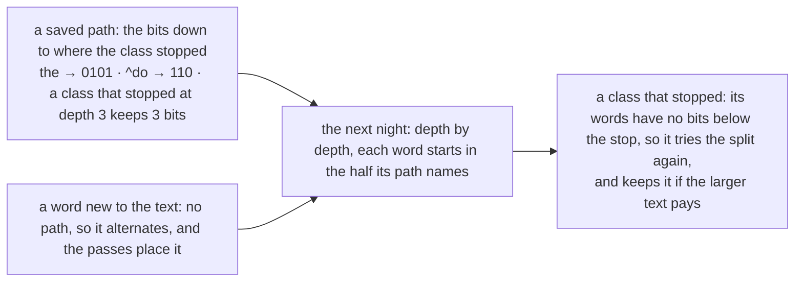

# learn: a night at a time

phisor learns every night and keeps what it learned. The night takes the next text from a queue, starts from the newest saved night, and saves where it got to. Every night is scored on the guide's held-out sentences, whose labels it is never told. The run is `examples/nightly`. `crates/phisor/nightly.ps1` runs it, and Task Scheduler starts that script every night at 02:00 ("phisor nightly"). The page `crates/phisor/data/learn/learned.html` draws it all.

## The nights

| night | text | training sentences | word classes | mode 64: function | mark | questions F1 | instructions F1 | seconds |
|---|---|---|---|---|---|---|---|---|
| before (2026-11-24, the guide alone) | the guide | 14,777 | 53 at depth 7 | 59.3% | 72.2% | 61.4% | 55.7% | |
| 2026-11-25-1250 | + tatoeba 1-2 | 172,435 | 151 at depth 9 | 59.4% | 74.1% | **68.5%** | 19.5% | 35 |
| 2026-11-25-1253 (resumed) | + tatoeba 3-4 | 327,670 | 198 at depth 10 | 60.2% | 74.3% | 68.8% | 34.2% | 48 |
| 2026-11-25-1258 (both starts; resumed kept) | + tatoeba 5-6 | 487,670 | 235 at depth 10 | 60.1% | 74.2% | 69.3% | 35.2% | 121 |
| 2026-11-26-0644 (the first scheduled night; resumed kept) | + tatoeba 7-8 | 647,670 | 267 at depth 11 | 60.5% | 74.7% | 68.5% | 0.0% | 97 |
| 2026-11-27-0040 (resumed kept) | + tatoeba 9-10 | 807,669 | 291 at depth 12 | 60.5% | 74.4% | 69.5% (lift 55.6%) | 0.0% (lift 17.9%) | 143 |

What the first night shows:
- **More text pays for more classes.** With 157,658 Tatoeba sentences beside the guide, the code pays for 151 classes at depth 9, against 53 at depth 7 on the guide alone. At mode 16 they read as parts of speech: `is was has had`, `the a his my your`, `out up here now back`, and Tatoeba's names `tom mary` in a class of their own.
- **Questions are sensed better, instructions worse.** At mode 64 the kinds sense the guide's questions at 68.5% F1, up from 61.4%. They sense its instructions at 19.5%, down from 55.7%. The guide's instructions are its exercise lines ("Complete the sentences…"). The likely reason, not yet checked, is that their openings now share kinds with Tatoeba's statements and orders, so fewer kinds have `instruct` as their dev majority. Each night's row will show whether more text parts them again.

## Sensing a rare label

The fourth night's instructions F1 fell to 0 while every other measure held. The kinds had not lost the instructions. The guide holds 98 held-out instructions against 1,641 explanations and 1,437 answers, and at mode 64 one kind (105) held 33 of them, a third. But it held 38 explanations too, and a kind answered only to the label most of its dev sentences carry. Dev holds about 50 instructions, so a few dev sentences tipped kind 105 to `explain` and no kind answered to `instruct`. The night before, the same kind (120 then) held 28 instructions against 18 explanations and answered to `instruct`: 35.2%.

So a kind can also be named by lift (`kind::Rule::Lift`): the label it holds the largest share of on dev, `n(kind, label) / n(label)`. A kind with a third of the instructions and a fortieth of the explanations is an instruction kind. It is still named on dev and scored on the held-out sentences. From 2026-11-27 each night records both: the majority F1 as before, so the nights stay comparable, and the lift F1 in the row's last columns. The kinds report keeps the majority.

The first night with both (2026-11-27-0040, mode 64): instructions 0.0% by the majority and 17.9% by lift, questions 69.5% and 55.6%. Lift never misses a rare label, but it names many small kinds for one too, so its precision falls on both. Neither rule is a fair sensor for a label that is 3% of the guide with about 50 dev sentences. A measure with no naming step, such as the held-out average precision of the kinds ranked by their dev share of a label, would not flip on one kind. It is not chosen yet: choosing among rules by these held-out numbers would be tuning on them.

## Resumed or fresh

Resuming keeps the tree where it was, but on the same text it does not learn better than a fresh start. The second night's four sources, learned both ways:

| the same 327,670 sentences | resumed from night 1 | fresh, from nothing |
|---|---|---|
| seconds | **48** | 82 |
| word classes | 198 at depth 10 | 207 at depth 10 |
| likelihood per pair (training) | −11.8829 | **−11.8805** |
| mode 64: function · mark | 60.2% · 74.3% | 60.1% · 74.9% |
| mode 64: questions · instructions F1 | 68.8% · 34.2% | **70.2% · 44.8%** |

The resumed tree stays near the one it grew on less text, a local optimum the passes do not leave. So from the third night both starts are learned and the better is kept (Liskov's better): the word code resumed from the saved paths and the word code learned fresh, judged on the training likelihood alone, never on the held-out labels. The kinds resume only when the code did, since their saved templates name the saved code's classes. `night.tsv`'s last column says which start won. What accumulates either way is the text taken and the record; the tree is the best either start finds.

## The files

| file | kept by | what |
|---|---|---|
| `data/learn/source.tsv` | hand (committed) | the queue: `name <tab> path`, a path from the phinet folder or absolute |
| `data/learn/taken.tsv` | the run | `stamp <tab> name <tab> sentences`, one line for each source taken |
| `data/learn/night.tsv` | the run | one row a night: sources, sentences, units, classes, depth, likelihood per pair, seconds, then per mode the templates, kinds, function and mark purity and the two F1s |
| `data/learn/state/<stamp>/` | the run | `code.tsv`, `kind-16/32/64.tsv` (`name <tab> path <tab> told or kind`), `label-N.tsv` (each kind's held-out labels), `growth.tsv` (depth by depth: splits kept, likelihood, gain per pass) |
| `data/learn/log/<stamp>.txt` | `nightly.ps1` | the night's output |
| `data/learn/learned.html` | the run | the page; `--page` draws it again without learning |

Everything under `data/learn` but `source.tsv` is git-ignored: the nights are the run's, and each keeps its own folder, so a bad night never overwrites a good one.
