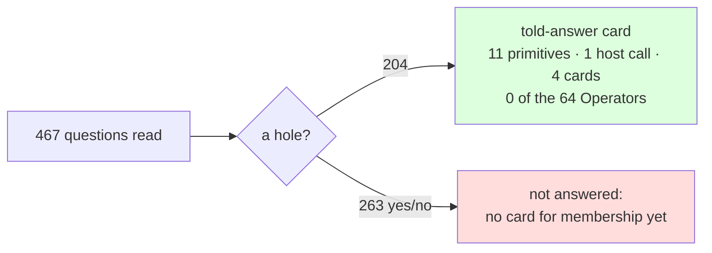

# what the guide's questions invoke on the mill — 2026-11-08

The count phisor's TODO asked for before any Operator is added to the keyboard: run the guide's own sentences through the engine, in their order, the statements told and the questions asked, and tally what answering invoked - which of phiclm's 40 primitives, which of the keyboard's 64 Operators, which cards, how often. The machine keeps the tally (`phiclm::lisp::Machine::tally`: every primitive and every named lambda it applies); `phisor::machine::usage` sorts it by what each name is; `examples/converse --guide murphy.txt --key murphy_key.txt --prime --usage` is the run.

```text
converse --prime --usage --guide crates/phiano/data/person/murphy.txt --key crates/phiano/data/person/murphy_key.txt
```

## The run

| | count |
|---|---|
| the guide's sentences (units; the Key never told) | 17,385 |
| read as statements and told (rows) | 4,031 (19,180) |
| read as questions and asked | 467 |
| answered over what was told | 204 |
| read as a question, no hole (yes/no), not answered | 263 |
| not read | 12,887 |

Two minutes and a half at low priority, most of it the reader.

## What answering invoked

| invoked | kind | times | per question |
|---|---|---|---|
| `=` · `car` · `length` | primitive | 2,153 each | 10.6 |
| `cdr` | primitive | 1,541 | 7.6 |
| `identity` · `referents` | primitive | 1,308 each | 6.4 |
| `union` | primitive | 1,179 | 5.8 |
| `list` | primitive | 612 | 3.0 |
| `meet` | primitive | 362 | 1.8 |
| `domain` · `image` | primitive | 204 each | 1.0 |
| `phisor-rows` | host | 1,949 | 9.6 |
| `union-all` | card | 1,587 | 7.8 |
| `meet-all` | card | 566 | 2.8 |
| `events` · `told-answer` · the question's own lambda | card | 204 each | 1.0 |

**204 questions · 11 of 40 primitives · 1 host call · 0 of 64 Operators · 5 cards.**



Read, straight:

- **None of the 64.** Every question the engine answered was answered by the store (`phisor-rows`, ten columns a question) and eleven set and list primitives composed by four cards. The keyboard's Operators - phasor arithmetic over the planes - are not what answering English is made of; they are what the learner is made of. The 64 stays 64. No Operator is missing; the TODO's rule holds and is now measured, not argued.
- **Eleven primitives, and eight of them are the cards' plumbing.** `=`, `car`, `cdr`, `length`, `list` and `union` are `union-all` and `meet-all` walking their argument lists; the answer itself is `identity`, `referents`, `meet`, `domain`, `image` - the five that docs/211 said, one fewer than the TODO's "six". A `fold` primitive would cut the per-question count by a third and is not worth a primitive: it is a card.
- **What is missing is a card, not an Operator.** 263 of the 467 questions read were yes/no questions - "do you know where she is?", "have you seen tom?" - an ASK with no hole. `told` has nothing to read off, and refuses. The operation is membership: whether the events the fixed roles name are more than none. That is `(> (count (events …)) 0)` - a one-line card over primitives the mill already has - plus the realiser saying *yes* or *no*. It is the next card to punch, and the first one the harness, rather than the writer, asked for.
- **The answers are not the point here**, and most are wrong in the way docs/211 expects: the guide's questions are exercises, not questions about what the guide told, so "where are you going?" is answered with every destination the guide ever mentioned. The count of what answering *used* is the point, and it is independent of whether the answer is right.
- **Three in four sentences are not read.** 12,887 of 17,385: the loom is the bottleneck, as paper 28 placed it. Every shape the reader gains is more store and more questions for the same five primitives.

## What changed to get this

- phiclm `lisp::Machine` keeps a tally: every `Prim` applied, every lambda applied by name (`tally`, `take_tally`). One test.
- phisor `machine::usage::Usage` (`of`, `add`, `distinct`, `Display` as a table); `machine::engine::Run` (answer, steps, usage) returned by `told::answer_told_traced_kinds`; `machine::answer_usage`. Two tests; 35 machine tests green.
- `examples/converse`: `--guide`, `--key`, `--usage`, and the refusals counted by cause.

## Then, the same hour: the card punched

`told-whether`, one line in `data/ops/core.lisp`: whether the events the fixed roles name are more than none - `(if (< 0 (count (events rels))) 'yes 'no)`. `told` takes a question with no hole to it. The run again:

| | before | after |
|---|---|---|
| questions read | 467 | 467 |
| answered | 204 | **467** (204 by the hole · 34 yes · 229 no) |
| primitives invoked | 11 of 40 | 13 of 40 (`<`, `count` joined) |
| cards | 5 | 6 |
| of the 64 Operators | 0 | **0** |

The operation the count found missing was supplied without touching the mill, as the rule says: a card over primitives it had. `no` is the store's closed world - "not among what was told" - and most of the 229 are that, since the guide's questions are exercises, not questions about what the guide told. The 34 yeses are where the guide asked back what it had just said ("is it still raining?" after "it is still raining"). One test; 36 machine tests green.
