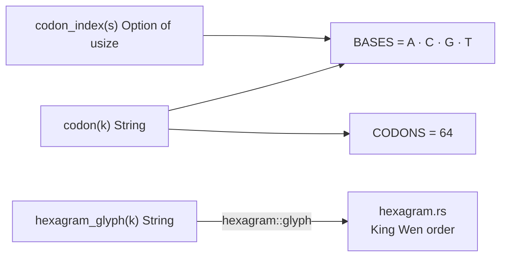
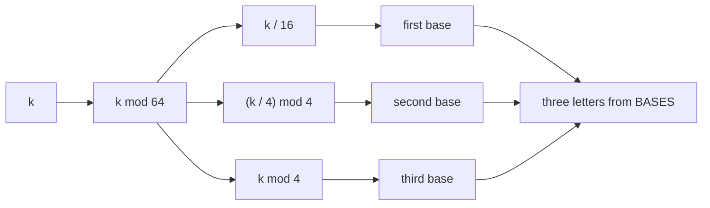
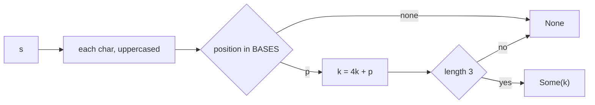
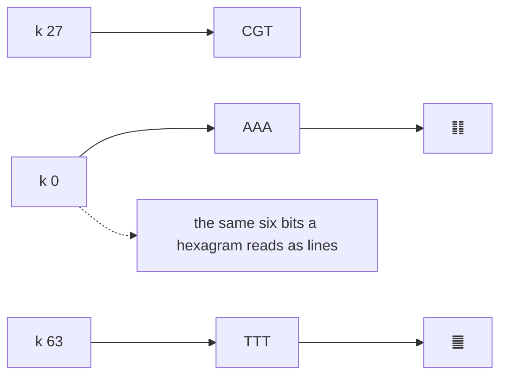
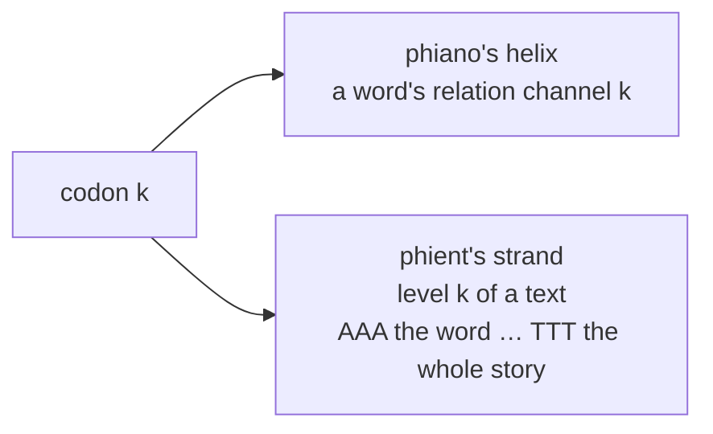
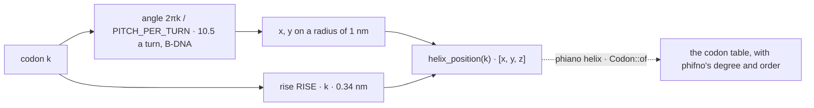

# codon

## Inside codon.rs

## k as three bases

## Back again — codon_index(s)

## The sixty-four, three ways — from the test

## Two readings — from the module doc

## The helix — where codon k sits

