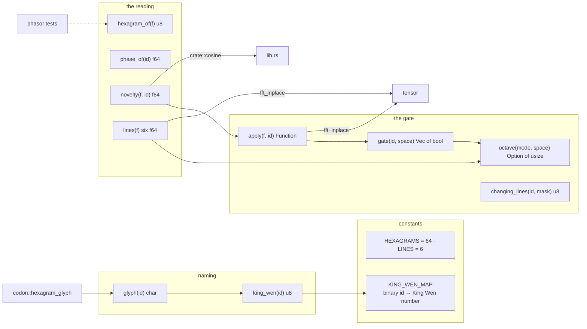
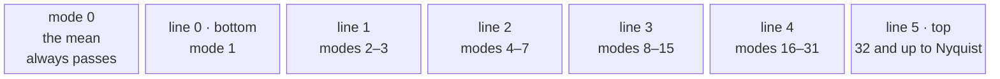
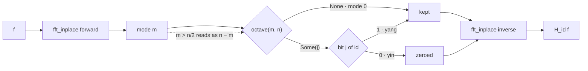
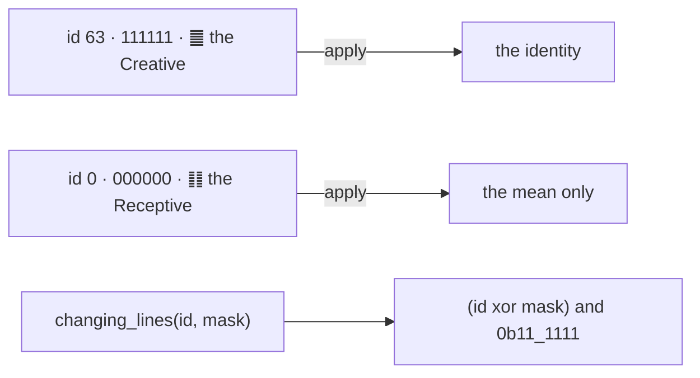
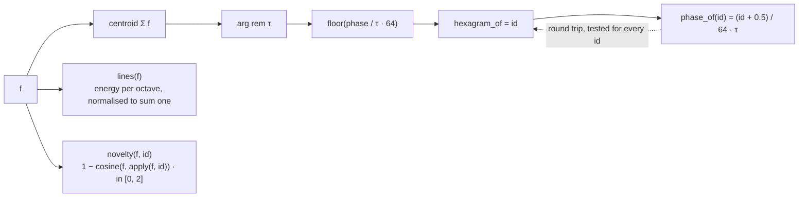
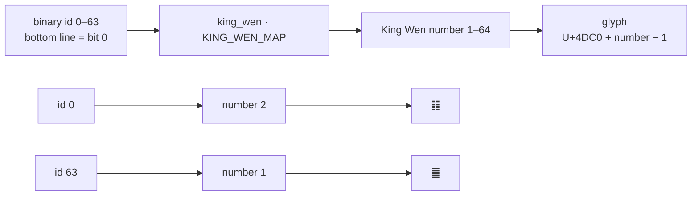
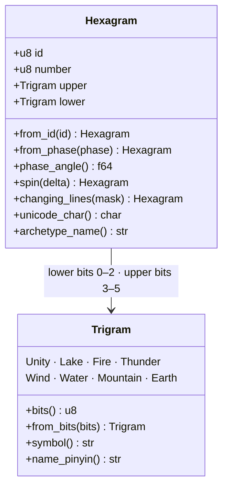
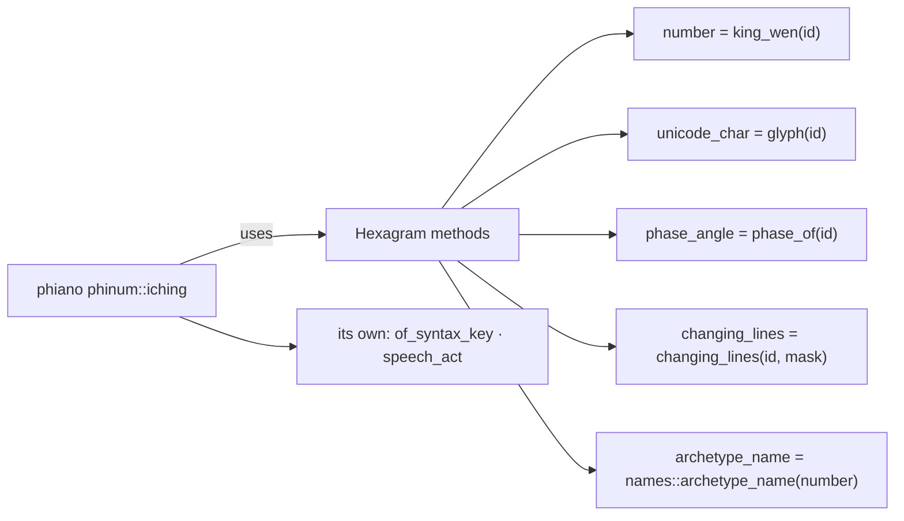

# hexagram

## Inside hexagram/

## Six lines, six octaves of the spectrum

## A gate — apply(f, id)

## The two ends, and the oracle's move

## The hexagram a function is

## Naming a hexagram

## The hexagram as a figure — figure.rs, trigram.rs, names.rs

