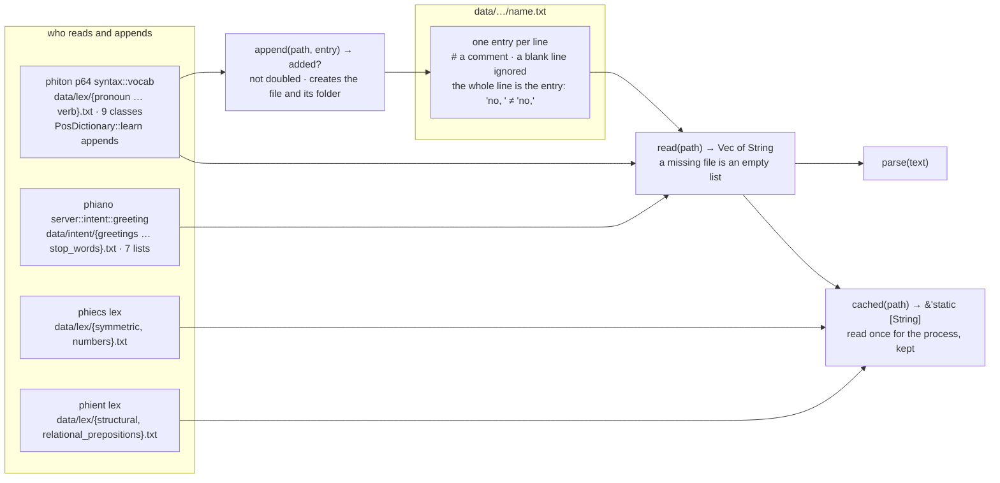

# lexfile: a word list in a file

The user's ruling of 2026-11-07: no linguistic data in code. Contractions, irregular verbs, closed-word lists, templates — every level of what is known lives in the file system, where a run can read it and append to it; the Rust keeps only the functions that find the abstractions. This is the one reader and appender every crate uses for it.

## The test

`a_list_is_read_appended_and_not_doubled`: a missing file reads as empty; `parse` drops comments and blanks and keeps a trailing space; `append` adds once, refuses a repeat and a blank, and `read` gives the two back in order; `cached` gives the same two and does not see an append made after its first read.
