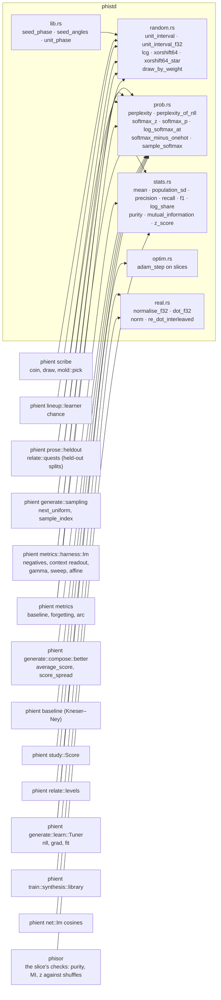

# numerics: random, stats, prob, real, optim

The plain numerics phient used to write inline (batch 2 of docs/phient/calculations, 2026-10-28), each written here exactly as the sites wrote it, so no recorded number moved.

Added 2026-10-29 for phisor's checks, new rather than moved: `precision` and `recall` (`f1` now reads them, with the same arithmetic), and a contingency table's `purity`, `mutual_information` in bits, and a `z_score` against a null.

