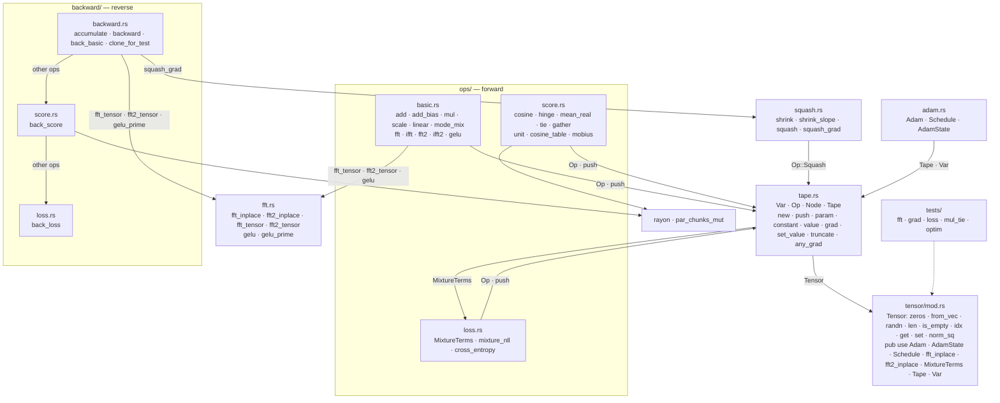
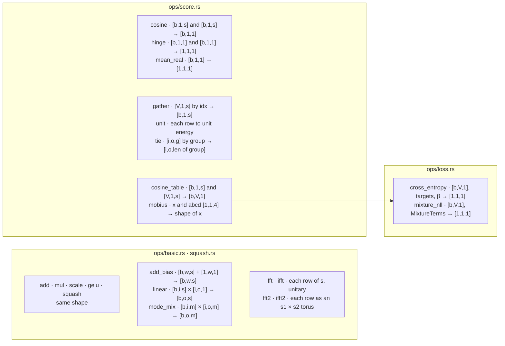
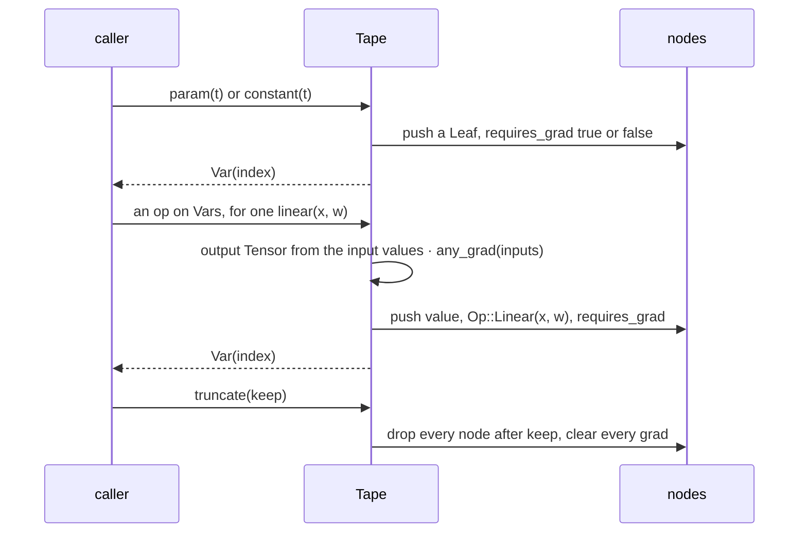
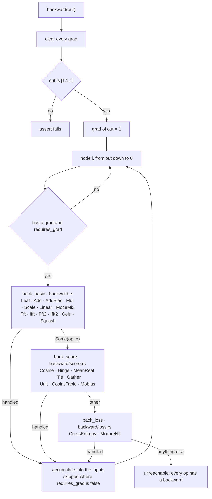
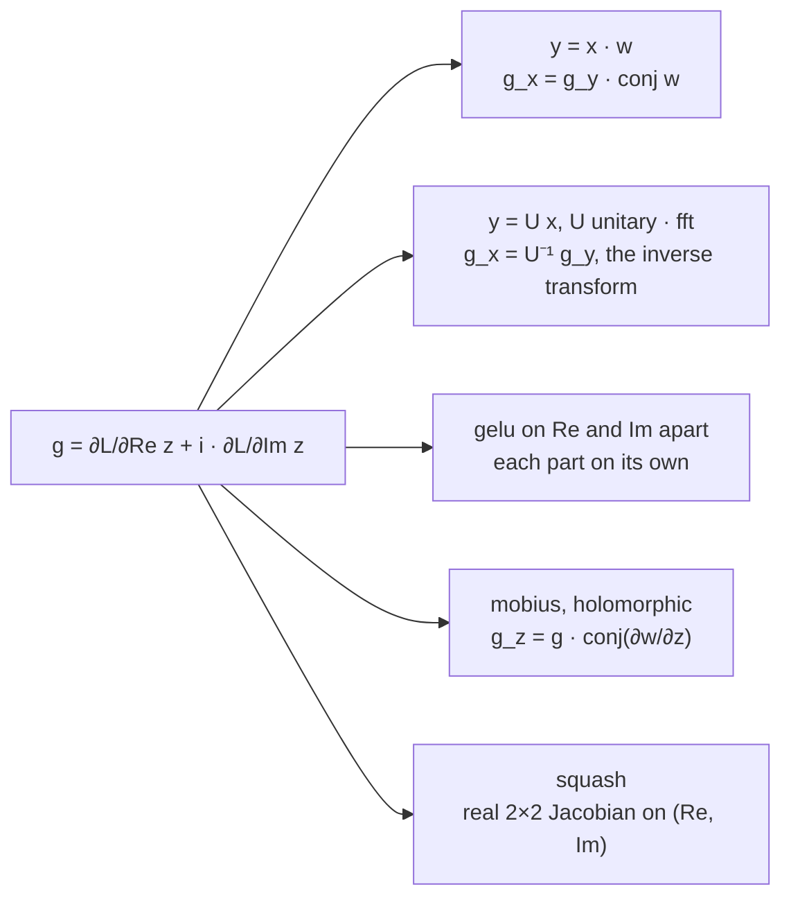
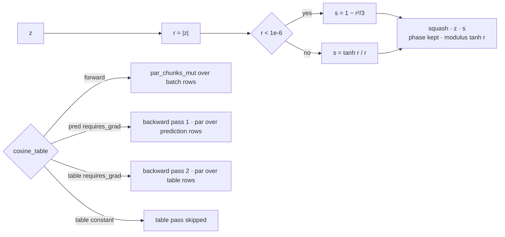
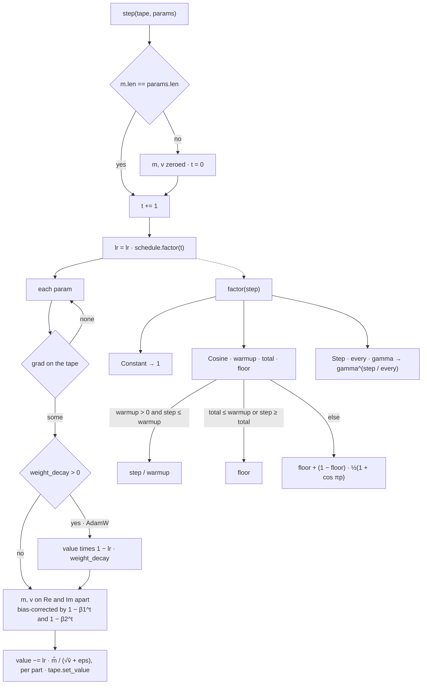
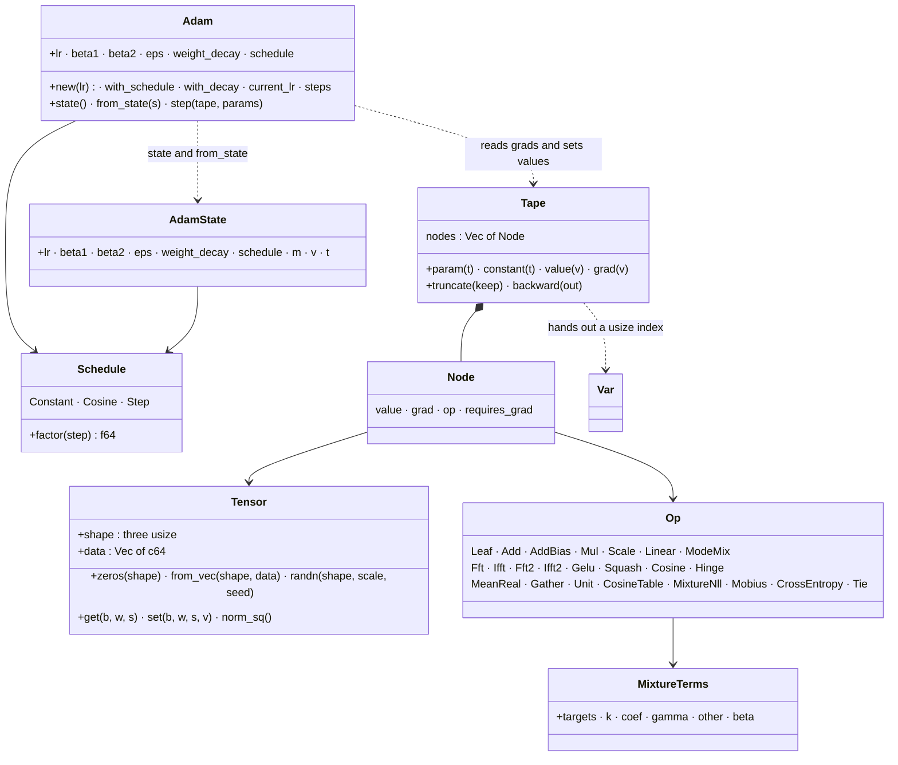

# tensor

## Files

## Shapes — every tensor is [batch, width, space]

## Recording on the tape

## backward(out) — and which file holds which Op

## The gradient convention

## squash and cosine_table

## Adam::step and Schedule::factor

## The types

