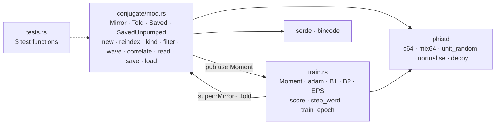
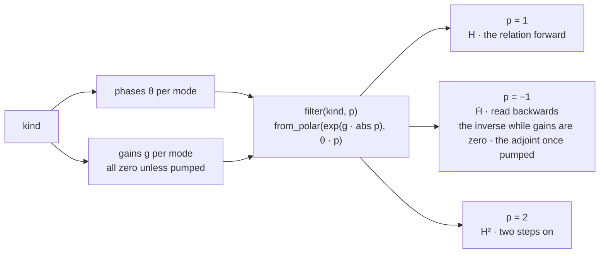
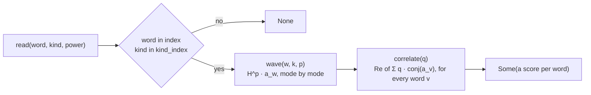
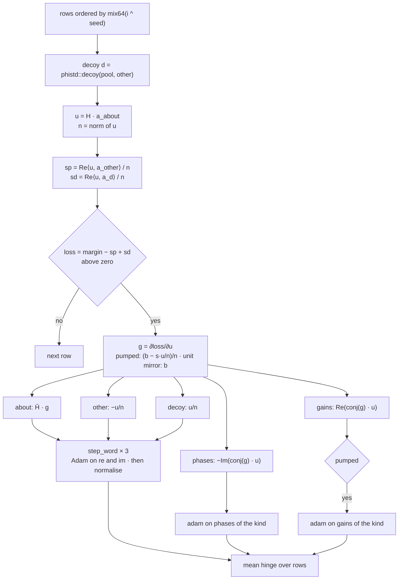
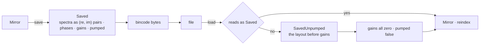
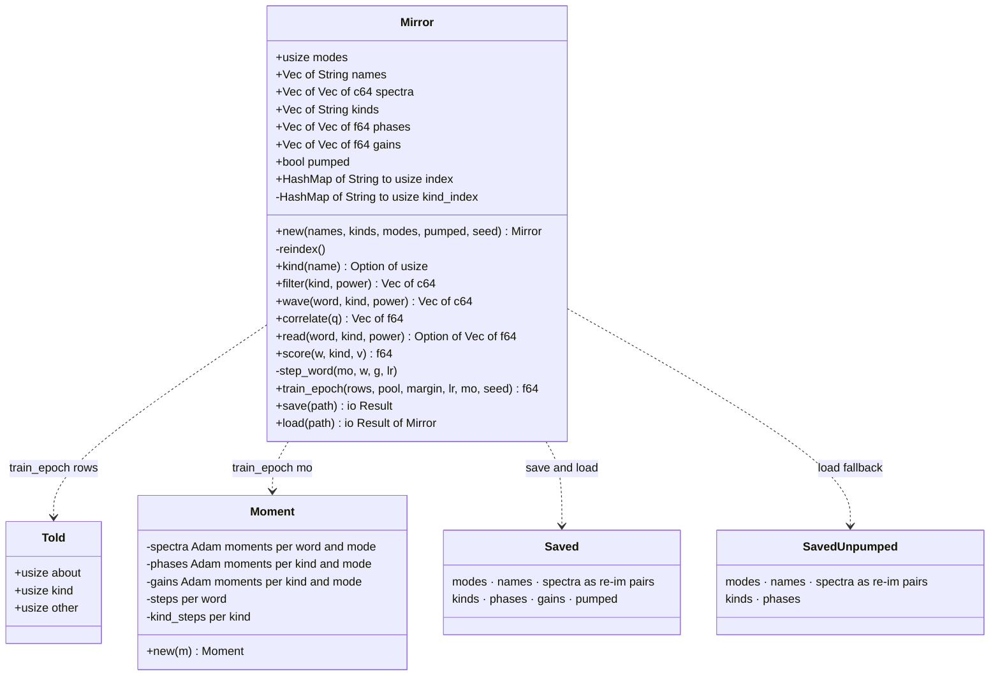

# conjugate

`phiton::conjugate`, beside `chiton`; it was phical's.

## Files

## A kind's filter, raised to a power

## A reading

## One told row in train_epoch

## Save and load

## The types

