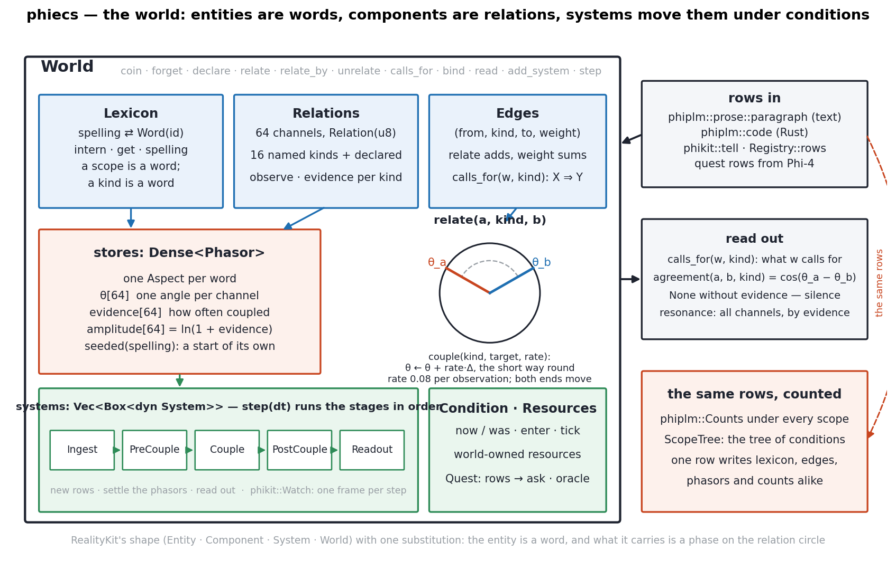
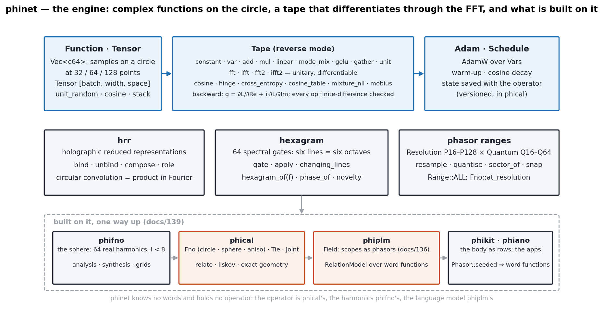
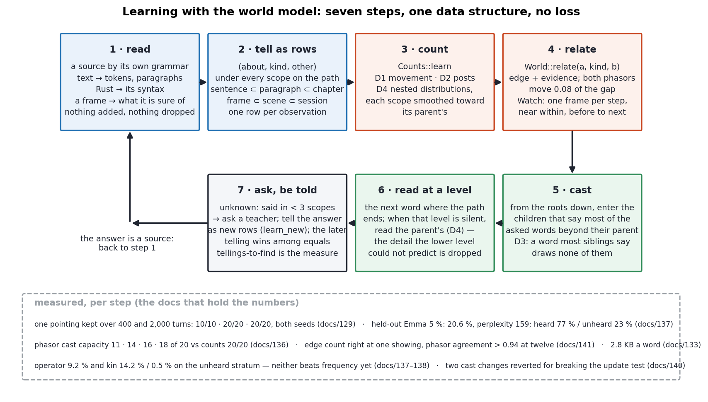

# The world model — phiecs and phinet drawn, and the learning steps

In Phient's world, a word (w) is a seed: what it relates to, under what conditions (c), grows from it. The Phical paradigm, X ⇒ Y, drives and composes Phient's Phasor Language Models: Phinet, Phiano, PhiTon. Phical stores no point: a word is 32–64 relations, each a complex phasor on a closed circle with a count; meaning is a side effect of pairs of words moving under a condition.

This is the fourth of the approach documents (`training.md`, `guard.md`, `ecs_vs_jepa.md`): the two engines drawn in detail, the learning steps walked through the world model, and the point the user made against the levels-of-abstraction argument — that each level is a model of its own, so the system is multi-model by design, and that what phiecs supplies is abstraction, modularity and recursion. Figures are generated by `docs/figs_world.py`; every number in them is from the numbered doc it names.

## 1. phiecs — the world

The world is RealityKit's shape with one substitution: the entity is a word, and what it carries is not a position in space but a phase on the relation circle. Reading the figure left to right and top to bottom:

The **Lexicon** interns spellings to `Word` ids. Everything that can be related is a word — including a scope (`scope:body/face/shape`) and a kind (`near`, `before`, `within`): that is the recursion the user named. A condition is a word, so a condition can be related to, counted under, and be a condition for other conditions.

**Relations** are the sixty-four channels: sixteen named kinds a fresh world knows (`is-a`, `part-of`, `has`, `near`, `before`, `after`, `causes`, …) and any kind `declare`d later, each observed and counted. **Edges** are the rows themselves, `(from, kind, to, weight)`; `calls_for(w, kind)` reads X ⇒ Y off them, heaviest first.

The one **Aspect** every word carries is the `Phasor`: sixty-four angles, one per channel, each with its evidence count and an amplitude `ln(1 + evidence)`. `Phasor::seeded(spelling)` gives a fresh word a start of its own on every channel. `relate(a, kind, b)` does three things and they are the whole of learning: record the edge, count the kind, and move both words' angles on that channel a step of the coupling rate (0.08) toward each other, the short way round. A word is thus "32–64 relations, each a complex phasor on a closed circle with a count" literally: the data structure is the sentence.

**Systems** run over the world in five stages per `step(dt)` — Ingest, PreCouple, Couple, PostCouple, Readout — an observation pipeline, not a frame pipeline; `dt` is one observation. phikit's `Watch` is a system: one frame per step, the shapes said together related `near`, each shape said related `before` each the next frame says (docs/141). **Condition** is the state machine (`now`, `was`, `enter`, `tick`) a persona or a quest runs under; **Resources** are world-owned; a **Quest** turns rows into asks and an oracle's answers back into rows.

On the right: what comes in (rows from prose, from Rust, from the kit, from Phi-4), what is read out (`calls_for`; `agreement(a, b, kind) = cos(θ_a − θ_b)`, `None` without evidence on both sides — silence is not agreement; `resonance` across channels weighted by the smaller evidence), and the fact that the *same* rows are counted into phiplm's `Counts` and `ScopeTree`. One row writes the lexicon, the edges, the phasors and the counts alike. That is why the three views of the model (training.md §1) never disagree.

## 2. phinet — the engine

phinet knows no words. It is the engine the continuous half of the family runs on — what torch is to neuraloperator (docs/139). A *function* is a `Vec<c64>`: a complex function sampled on a circle at 32, 64 or 128 points; a `Tensor` is `[batch, width, space]` of them. The `Tape` is reverse-mode autodiff with a unitary FFT among its ops (`fft`, `ifft`, `fft2`, `ifft2`), the usual arithmetic and `linear`, the spectral `mode_mix`, `gelu`, `gather`, `unit`, and the losses the family uses — `cosine`, `hinge`, `cross_entropy`, the parallel `cosine_table`, `mixture_nll`, `mobius`. Gradients of a real loss with respect to complex values follow `g = ∂L/∂Re + i·∂L/∂Im`, and every op is finite-difference checked. `Adam` (AdamW with a warm-up and cosine `Schedule`) is the optimiser; phical saves its state with the operator.

Beside the tape: `hrr` (holographic reduced representations — bind, unbind, compose, role; circular convolution is a product in Fourier), `hexagram` (the sixty-four spectral gates: six lines are six octaves of the spectrum; `hexagram_of(f)` is the hexagram a function is; `novelty` how far it is from one), and the phasor `Range`s (`Resolution` P16–P128 × `Quantum` Q16–Q64; `resample`, `quantise`, `snap`; `Fno::at_resolution` moves an operator between them).

Built on it, one way up: phifno (the sphere: sixty-four real harmonics with l < 8, analysis and synthesis), phical (the Fourier neural operator on the circle, the sphere and anisotropically; `Tie`, `Joint`, the relation operators, Liskov, the exact geometry), phiplm (the `Field` of docs/136 — scopes as phasors — and the `RelationModel` over a table of word functions), phikit and phiano (seeded word functions from the world's `Phasor::angles()`).

Where phiecs is discrete and counts, phinet is continuous and differentiates. The division is the honest one: the counts are the base and learn from one telling; the operators are an addition over them and are measured against them (docs/137: the operator does not yet beat frequency in the unheard stratum).

## 3. The learning steps, with the world model

1. **Read.** A source by its own grammar: text into tokens and paragraphs (`phiplm::prose`), Rust by its syntax (`phiplm::code`), a tracked face into the sentence of what it is sure of (`phikit::body::Face::sentence`), a framework into its names' words (`phikit::tell`). The reader adds nothing and drops nothing: a name is its words, a frame is a sentence.
2. **Tell as rows.** Every observation is a row `(about, kind, other)` under every scope on its path — the sentence in the paragraph in the chapter; the frame in the scene in the session; the thing under its kind, module and domain. One row per observation; no epochs.
3. **Count.** `Counts::learn`: the word's movement (D1), its posts — what came before it (D2) — and the nested distributions, each scope's smoothed toward its parent's (D4). Every scope's column of the matrix `count(word, condition)` is filled by exactly the rows told under it.
4. **Relate.** `World::relate` for the same rows: an edge, evidence, and the two phasors a step closer on that channel. The `Watch` system does this one frame per step for a body. Measured (docs/141): the edge count is right at the first showing; the phasor agreement passes 0.94 at twelve.
5. **Cast.** A question is words; the cast enters, from the roots down, the children that say most of the asked words *beyond their parent* (D3: a word most siblings say draws none of them; D4: a child's distribution against its parent's as base). The path it ends on is the condition the question is in.
6. **Read at a level.** The next word is read where the path ends, by that scope's nested distribution; when that level is silent, the parent's speaks, and the detail the lower level could not predict is dropped — which is the JEPA argument's abstraction, done by the structure rather than by an encoder. Held-out: 20.6 % next-word accuracy, perplexity 159, in two strata, 77 % heard and 23 % unheard (docs/137).
7. **Ask, be told.** What the tree does not know — a word said in fewer than three scopes — it asks for; the teacher's answer is a source and goes back to step 1 as new rows (`learn_new`); among equals the later telling wins (now over was), so correction is telling again. The measure of the system is the number of tellings a thing needs before it is found (Piaget; docs/129, 130, 140).

Nothing in these seven steps minimises a loss. The one place a loss exists is the operator on top (phical's `Fno`, trained by a margin `hinge` on cosine similarity against a sampled decoy — a *sample-contrastive* criterion, in LeCun's terms, docs/91–97), and it is kept beside the counts, not under them, until it is shown to find what the counts find.

## 4. Each level is a model of its own

The levels-of-abstraction argument says: particles, molecules, cells, organisms, societies — each level ignores the details of the one below and predicts further ahead; chemistry contains structure that is not apparent in physics; you simulate air with Navier–Stokes, not with molecules, because the molecular simulation would diverge from reality by having too many details. JEPA's claim is that an encoder must *find* such a level for prediction to be possible.

In the tree the levels are not found; they are the conditions the source was told under, and — the user's point — **each level is a model of its own**. A paragraph's scope holds a distribution over the words said in it; the chapter's holds the distribution over all its paragraphs; the book's over all its chapters; and D4 makes each the base of the one below. A cast reads at the lowest level that has counts and otherwise one up, so the prediction is always made by the smallest model that has something to say, and the larger models stand behind it. That is a multi-model system by design: not one network that must learn where to abstract, but a tree of distributions, each a model at its level, each nested in the one above, with one rule (`ln(p_level / p_parent)`) for what a level adds beyond its parent. The same holds for the body: the shape's coefficient is below the thing; the thing is under its kind; the kind under its module and domain (docs/141), and a cast for `jaw open` is answered at the thing, for `floor` at three kinds (a plane's classification, a room's surface, a mesh's class), for `provider class` at a key and a field — each the smallest model that says the words.

What phiecs contributes to this, named as the user named it:

- **Abstraction** — a scope is a word, so a level is an entity like any other: it has a phasor, it can be related to, it can be a condition for the levels below. The levels are first-class, not implicit in weights.
- **Modularity** — aspects and systems compose: the `Phasor` is one aspect among those a word may carry; `Watch` is one system among those a world may run; the crates stack one way (phinet ← phifno ← phical ← phiplm ← phikit ← phiano, phiecs beside; docs/139), and a module of phikit is a subtree with its own `told()`.
- **Recursion** — the tree is scopes within scopes to any depth; a quest's answers are rows that become sources; a world's `Phasor::angles()` seed the field's word functions, which are cast by the same tree. The same step applies at every level because every level is made of the same thing.

The row-and-column point from the talk maps exactly. JEPA's matrix is samples × variables, and a loss must make the rows different (sample-contrastive) or the columns different (dimension-contrastive) or the representation collapses. The tree's matrix is words × conditions with a count in every cell. Its rows differ because words are told apart by spelling; its columns differ because a child condition is read only beyond its parent — two columns that say the same thing add nothing by D4 and draw nothing by D3. Nothing needs to be maximised for this matrix to be informative, and its information content is computed, not estimated (guard.md §7). The honest limits stay as they were stated in `ecs_vs_jepa.md`: the tree does not perceive, the unheard stratum falls to the prior, and where the system uses a continuous summary of itself — the field, the coupled phasors, the operator — it pays what JEPA pays and reports it.

`python3 docs/figs_world.py` · `cargo run -p phikit --example watch -- 12` · `cargo run --release --bin context -- --turns 2000 --seed 2`
